# SRS hiện trạng, Phần 4: Mô hình dữ liệu

Nguồn: `db/group-7.sql` (schema gốc), `db/patch_01_users_unique.sql`, `db/seed.sql`. Bảng này được sinh tự động từ file SQL nên khớp với file, nhưng mô tả mục đích bảng lấy từ comment trong SQL, không phải từ code.

[CODE] Đếm: 56 lệnh `CREATE TABLE` trong `group-7.sql` và 56 entity trong `src/main/java/com/group7/minihouse/shared/entity` (57 file, trong đó `UserRoleId.java` là lớp khóa ghép, không phải entity). Tên bảng ở hai phía khớp 100%. Tên cột trong `@Column`/`@JoinColumn` của entity khớp với tên cột trong SQL cho cả 56 bảng (kiểm bằng script so sánh tập tên cột). Kiểu dữ liệu và độ dài chưa được so sánh [KHÔNG RÕ].

[CODE] `spring.jpa.hibernate.ddl-auto=validate` (application.properties), nên Hibernate đối chiếu entity với DB thật lúc khởi động; lệch thì app không chạy.

[CODE] Không có bảng xóa mềm (không có cột `is_deleted`/`deleted_at` dùng chung). Cột `is_active` có ở vài bảng (xe, người ở cùng, danh mục sự cố, mẫu thông báo, dịch vụ).

## 4.1 ERD (Mermaid)

Chỉ vẽ khóa ngoại (quan hệ n-1). Cột khóa ngoại nằm ở bảng đứng trước mũi tên.

```mermaid
erDiagram
    users ||--o{ user_verifications : "user_id"
    users ||--o{ user_roles : "user_id"
    roles ||--o{ user_roles : "role_id"
    users ||--o{ user_activity_logs : "user_id"
    users ||--o{ properties : "landlord_id"
    properties ||--o{ property_floors : "property_id"
    properties ||--o{ rooms : "property_id"
    property_floors ||--o{ rooms : "floor_id"
    rooms ||--o{ room_media : "room_id"
    rooms ||--o{ room_furnishings : "room_id"
    tenants ||--o{ tenant_id_cards : "tenant_id"
    rooms ||--o{ room_residents : "room_id"
    tenants ||--o{ room_residents : "tenant_id"
    tenants ||--o{ resident_stay_histories : "tenant_id"
    rooms ||--o{ resident_stay_histories : "room_id"
    rooms ||--o{ booking_requests : "room_id"
    tenants ||--o{ booking_requests : "tenant_id"
    rooms ||--o{ rental_contracts : "room_id"
    tenants ||--o{ rental_contracts : "tenant_id"
    contract_templates ||--o{ rental_contracts : "template_id"
    rental_contracts ||--o{ contract_adjustments : "contract_id"
    users ||--o{ contract_adjustments : "adjusted_by"
    rental_contracts ||--o{ contract_notifications : "contract_id"
    properties ||--o{ utility_reading_periods : "property_id"
    utility_reading_periods ||--o{ meter_readings : "period_id"
    rooms ||--o{ meter_readings : "room_id"
    users ||--o{ meter_readings : "recorded_by_user_id"
    meter_readings ||--o{ meter_photos : "reading_id"
    meter_readings ||--o{ meter_adjustment_logs : "reading_id"
    users ||--o{ meter_adjustment_logs : "adjusted_by"
    meter_readings ||--o{ meter_anomaly_alerts : "reading_id"
    properties ||--o{ property_service_rates : "property_id"
    rooms ||--o{ room_custom_rates : "room_id"
    properties ||--o{ rate_change_histories : "property_id"
    users ||--o{ rate_change_histories : "changed_by"
    properties ||--o{ monthly_billing_periods : "property_id"
    monthly_billing_periods ||--o{ calculated_monthly_fees : "billing_period_id"
    rooms ||--o{ calculated_monthly_fees : "room_id"
    rental_contracts ||--o{ calculated_monthly_fees : "contract_id"
    calculated_monthly_fees ||--o{ fee_item_details : "calculated_fee_id"
    calculated_monthly_fees ||--o{ invoices : "calculated_fee_id"
    tenants ||--o{ invoices : "tenant_id"
    invoices ||--o{ invoice_notifications : "invoice_id"
    invoices ||--o{ payment_transactions : "invoice_id"
    users ||--o{ payment_transactions : "received_by_user_id"
    payment_transactions ||--o{ receipt_vouchers : "transaction_id"
    invoices ||--o{ partial_payment_logs : "invoice_id"
    tenants ||--o{ tenant_prepayments : "tenant_id"
    tenant_prepayments ||--o{ prepayment_deductions : "prepayment_id"
    invoices ||--o{ prepayment_deductions : "target_invoice_id"
    tenants ||--o{ tenant_debts : "tenant_id"
    rooms ||--o{ tenant_debts : "room_id"
    invoices ||--o{ tenant_debts : "invoice_id"
    tenant_debts ||--o{ debt_penalty_logs : "debt_id"
    tenant_debts ||--o{ debt_reminders : "debt_id"
    tenant_debts ||--o{ debt_processing_logs : "debt_id"
    users ||--o{ debt_processing_logs : "recorded_by"
    rental_contracts ||--o{ checkout_requests : "contract_id"
    checkout_requests ||--o{ checkout_inspections : "checkout_id"
    users ||--o{ checkout_inspections : "inspected_by"
    checkout_requests ||--o{ deposit_refund_vouchers : "checkout_id"
    rooms ||--o{ maintenance_requests : "room_id"
    tenants ||--o{ maintenance_requests : "tenant_id"
    maintenance_requests ||--o{ maintenance_logs : "request_id"
    users ||--o{ maintenance_logs : "assigned_staff_id"
    tenants ||--o{ tenant_vehicles : "tenant_id"
    rooms ||--o{ room_equipment_requests : "room_id"
    tenants ||--o{ room_equipment_requests : "tenant_id"
    incident_categories ||--o{ room_equipment_requests : "category_id"
    users ||--o{ room_equipment_requests : "reviewed_by"
    rooms ||--o{ room_addon_fees : "room_id"
    room_equipment_requests ||--o{ room_addon_fees : "equipment_request_id"
    properties ||--o{ operating_expenses : "property_id"
    users ||--o{ operating_expenses : "recorded_by"
    properties ||--o{ bank_accounts : "property_id"
    users ||--o{ user_notifications : "user_id"
    notification_templates ||--o{ user_notifications : "notif_template_id"
```

## 4.2 Danh sách bảng

| # | Bảng | Mô tả (comment trong SQL) | Số cột |
|---|---|---|---|
| 1 | `users` | 1. Bảng người dùng (Chủ nhà & Nhân viên) | 9 |
| 2 | `user_verifications` | 2. Mã xác thực OTP Email / SĐT | 6 |
| 3 | `roles` | 3. Vai trò hệ thống (LANDLORD, MANAGER, CASHIER, METER_READER) | 4 |
| 4 | `permissions` | 4. Quyền hệ thống chi tiết | 4 |
| 5 | `user_roles` | 5. Gán vai trò cho nhân viên | 3 |
| 6 | `user_activity_logs` | 6. Xem lịch sử đăng nhập & Thao tác hệ thống | 6 |
| 7 | `properties` | 7. Khu nhà trọ | 7 |
| 8 | `property_floors` | 8. Tầng trong khu nhà trọ | 4 |
| 9 | `rooms` | 9. Danh mục Phòng trọ | 12 |
| 10 | `room_media` | 10. Hình ảnh phòng trọ | 4 |
| 11 | `room_furnishings` | 11. Ghi nhận trang thiết bị & Nội thất có sẵn trong phòng | 6 |
| 12 | `tenants` | 12. Hồ sơ Khách thuê chính (Đứng tên hợp đồng) | 12 |
| 13 | `tenant_id_cards` | 13. Ảnh CCCD mặt trước/sau của khách thuê | 5 |
| 14 | `room_residents` | 14. Danh sách Người ở cùng trong phòng | 10 |
| 15 | `resident_stay_histories` | 15. Tra cứu Lịch sử cư trú / ở trọ của khách | 6 |
| 16 | `booking_requests` | 16. Yêu cầu đặt giữ chỗ / Thuê phòng | 9 |
| 17 | `contract_templates` | 17. Mẫu điều khoản hợp đồng thuê trọ | 4 |
| 18 | `rental_contracts` | 18. Hợp đồng Thuê phòng chính | 19 |
| 19 | `contract_adjustments` | 19. Lịch sử điều chỉnh hợp đồng (Đổi giá, Đổi người...) | 7 |
| 20 | `contract_notifications` | 20. Thông báo hợp đồng sắp hết hạn | 5 |
| 21 | `utility_reading_periods` | 21. Kỳ ghi nhận chỉ số điện nước hàng tháng | 6 |
| 22 | `meter_readings` | 22. Ghi nhận chỉ số Điện & Nước từng phòng | 12 |
| 23 | `meter_photos` | 23. Ảnh chụp công tơ điện & đồng hồ nước minh bạch | 4 |
| 24 | `meter_adjustment_logs` | 24. Nhật ký điều chỉnh chỉ số điện nước | 8 |
| 25 | `meter_anomaly_alerts` | 25. Cảnh báo chỉ số tiêu thụ bất thường (Tăng đột biến) | 6 |
| 26 | `service_rate_plans` | 26. Gói đơn giá dịch vụ (Điện, Nước, Internet, Vệ sinh, Rác, Xe...) | 6 |
| 27 | `property_service_rates` | 27. Đơn giá dịch vụ áp dụng riêng cho từng Khu trọ | 6 |
| 28 | `room_custom_rates` | 28. Đơn giá dịch vụ / Giá thuê tùy chỉnh riêng cho từng Phòng | 5 |
| 29 | `rate_change_histories` | 29. Tra cứu Lịch sử thay đổi đơn giá | 7 |
| 30 | `monthly_billing_periods` | 30. Kỳ tính tiền hàng tháng (Billing Period) | 5 |
| 31 | `calculated_monthly_fees` | 31. Bảng tính tiền tổng hợp từng phòng trong kỳ | 12 |
| 32 | `fee_item_details` | 32. Bảng chi tiết từng khoản phí trong kỳ tính tiền | 6 |
| 33 | `invoices` | 33. Hóa đơn tiền phòng hàng tháng (Issued Invoices) | 12 |
| 34 | `invoice_notifications` | 34. Thông báo gửi hóa đơn qua Email / App | 5 |
| 35 | `payment_transactions` | 35. Giao dịch Thanh toán Hóa đơn | 8 |
| 36 | `receipt_vouchers` | 36. Phiếu thu tiền phòng / Đặt cọc / Dịch vụ | 7 |
| 37 | `partial_payment_logs` | 37. Ghi nhận thanh toán một phần / nhiều lần | 5 |
| 38 | `tenant_prepayments` | 38. Tài khoản dư tiền / Thanh toán thừa của Khách | 4 |
| 39 | `prepayment_deductions` | 39. Nhật ký cấn trừ tiền dư vào kỳ tiếp theo | 5 |
| 40 | `tenant_debts` | 40. Sổ theo dõi Công nợ Khách thuê & Phòng trọ | 10 |
| 41 | `debt_penalty_logs` | 41. Nhật ký phạt tiền chậm thanh toán | 6 |
| 42 | `debt_reminders` | 42. Thông báo nhắc nợ (Tự động 1st, 2nd, Cảnh báo quá hạn) | 5 |
| 43 | `debt_processing_logs` | 43. Ghi nhận lịch sử cam kết & Xử lý nợ | 7 |
| 44 | `checkout_requests` | 44. Tiếp nhận Yêu cầu Trả phòng & Thanh lý Hợp đồng | 6 |
| 45 | `checkout_inspections` | 45. Biên bản kiểm tra phòng & Bồi thường hư hỏng tài sản khi trả | 10 |
| 46 | `deposit_refund_vouchers` | 46. Phiếu hoàn tiền đặt cọc (Sau cấn trừ công nợ & hư hỏng) | 8 |
| 47 | `maintenance_requests` | 47. Yêu cầu Sửa chữa Sự cố Điện / Nước / Thiết bị phòng | 9 |
| 48 | `maintenance_logs` | 48. Phân công Nhân viên & Chi phí Sửa chữa Sự cố | 7 |
| 49 | `tenant_vehicles` | 49. Phương tiện của khách thuê (Usecase 34) | 8 |
| 50 | `incident_categories` | 50. Danh mục nhóm sự cố & nhóm thiết bị (Usecase 113) | 6 |
| 51 | `room_equipment_requests` | 51. Yêu cầu sử dụng thêm / lắp đặt thiết bị trong phòng (Usecase 108) | 11 |
| 52 | `room_addon_fees` | 52. Phí tiện ích bổ sung theo phòng (thiết bị điện, dịch vụ theo kỳ) (Usecase 109) | 9 |
| 53 | `operating_expenses` | 53. Chi phí vận hành khu trọ (bảo trì, vệ sinh, thuế...) (Usecase 117, 118) | 9 |
| 54 | `bank_accounts` | 54. Tài khoản ngân hàng & mã QR nhận tiền (Usecase 119) | 8 |
| 55 | `notification_templates` | 55. Mẫu thông báo & kênh gửi (email, website) (Usecase 121) | 6 |
| 56 | `user_notifications` | 56. Trung tâm thông báo của người dùng (xem, đánh dấu đã đọc, xóa) (Usecase 123) | 9 |

## 4.3 Chi tiết từng bảng

### `users`

1. Bảng người dùng (Chủ nhà & Nhân viên)

| Trường | Kiểu | Null? | Mặc định | Khóa / ràng buộc |
|---|---|---|---|---|
| `user_id` | INT | NOT NULL |  | PK; IDENTITY |
| `email` | NVARCHAR(255) | NULL |  |  |
| `phone_number` | VARCHAR(20) | NULL |  |  |
| `password_hash` | NVARCHAR(255) | NOT NULL |  |  |
| `full_name` | NVARCHAR(100) | NOT NULL |  |  |
| `avatar_url` | NVARCHAR(500) | NULL |  |  |
| `status` | NVARCHAR(20) | NOT NULL | 'ACTIVE' | CHECK IN ('ACTIVE', 'INACTIVE', 'LOCKED') |
| `created_at` | DATE | NOT NULL | GETDATE() |  |
| `updated_at` | DATE | NOT NULL | GETDATE() |  |

### `user_verifications`

2. Mã xác thực OTP Email / SĐT

| Trường | Kiểu | Null? | Mặc định | Khóa / ràng buộc |
|---|---|---|---|---|
| `verification_id` | INT | NOT NULL |  | PK; IDENTITY |
| `user_id` | INT | NOT NULL |  | FK → users.user_id; ON DELETE CASCADE |
| `type` | NVARCHAR(20) | NOT NULL |  | CHECK IN ('EMAIL', 'PHONE', 'RECOVERY') |
| `code` | VARCHAR(10) | NOT NULL |  |  |
| `expires_at` | DATE | NOT NULL |  |  |
| `is_verified` | BIT | NOT NULL | 0 |  |

### `roles`

3. Vai trò hệ thống (LANDLORD, MANAGER, CASHIER, METER_READER)

| Trường | Kiểu | Null? | Mặc định | Khóa / ràng buộc |
|---|---|---|---|---|
| `role_id` | INT | NOT NULL |  | PK; IDENTITY |
| `role_code` | VARCHAR(50) | NOT NULL |  | UNIQUE |
| `role_name` | NVARCHAR(100) | NOT NULL |  |  |
| `description` | NVARCHAR(255) | NULL |  |  |

### `permissions`

4. Quyền hệ thống chi tiết

| Trường | Kiểu | Null? | Mặc định | Khóa / ràng buộc |
|---|---|---|---|---|
| `permission_id` | INT | NOT NULL |  | PK; IDENTITY |
| `permission_code` | VARCHAR(100) | NOT NULL |  | UNIQUE |
| `permission_name` | NVARCHAR(100) | NOT NULL |  |  |
| `module` | VARCHAR(50) | NOT NULL |  |  |

### `user_roles`

5. Gán vai trò cho nhân viên

| Trường | Kiểu | Null? | Mặc định | Khóa / ràng buộc |
|---|---|---|---|---|
| `user_id` | INT | NOT NULL |  | FK → users.user_id; ON DELETE CASCADE |
| `role_id` | INT | NOT NULL |  | FK → roles.role_id; ON DELETE CASCADE |
| `assigned_at` | DATE | NOT NULL | GETDATE() |  |

Ràng buộc mức bảng: `PRIMARY KEY ([user_id], [role_id])`

### `user_activity_logs`

6. Xem lịch sử đăng nhập & Thao tác hệ thống

| Trường | Kiểu | Null? | Mặc định | Khóa / ràng buộc |
|---|---|---|---|---|
| `log_id` | INT | NOT NULL |  | PK; IDENTITY |
| `user_id` | INT | NOT NULL |  | FK → users.user_id |
| `action_type` | VARCHAR(50) | NOT NULL |  |  |
| `description` | NVARCHAR(MAX) | NULL |  |  |
| `ip_address` | VARCHAR(45) | NULL |  |  |
| `created_at` | DATE | NOT NULL | GETDATE() |  |

### `properties`

7. Khu nhà trọ

| Trường | Kiểu | Null? | Mặc định | Khóa / ràng buộc |
|---|---|---|---|---|
| `property_id` | INT | NOT NULL |  | PK; IDENTITY |
| `landlord_id` | INT | NOT NULL |  | FK → users.user_id |
| `property_name` | NVARCHAR(150) | NOT NULL |  |  |
| `address` | NVARCHAR(255) | NOT NULL |  |  |
| `total_floors` | INT | NULL | 1 |  |
| `support_phone` | VARCHAR(20) | NULL |  |  |
| `created_at` | DATE | NOT NULL | GETDATE() |  |

### `property_floors`

8. Tầng trong khu nhà trọ

| Trường | Kiểu | Null? | Mặc định | Khóa / ràng buộc |
|---|---|---|---|---|
| `floor_id` | INT | NOT NULL |  | PK; IDENTITY |
| `property_id` | INT | NOT NULL |  | FK → properties.property_id; ON DELETE CASCADE |
| `floor_number` | INT | NOT NULL |  |  |
| `floor_name` | NVARCHAR(50) | NOT NULL |  |  |

Ràng buộc mức bảng: `CONSTRAINT [UQ_property_floor] UNIQUE([property_id], [floor_number])`

### `rooms`

9. Danh mục Phòng trọ

| Trường | Kiểu | Null? | Mặc định | Khóa / ràng buộc |
|---|---|---|---|---|
| `room_id` | INT | NOT NULL |  | PK; IDENTITY |
| `property_id` | INT | NOT NULL |  | FK → properties.property_id |
| `floor_id` | INT | NOT NULL |  | FK → property_floors.floor_id |
| `room_code` | VARCHAR(50) | NOT NULL |  |  |
| `area_sqm` | DECIMAL(5,2) | NOT NULL |  |  |
| `max_occupants` | INT | NOT NULL | 2 |  |
| `base_rent_price` | DECIMAL(18,2) | NOT NULL |  |  |
| `deposit_amount` | DECIMAL(18,2) | NOT NULL |  |  |
| `initial_electric_meter` | INT | NOT NULL | 0 |  |
| `initial_water_meter` | INT | NOT NULL | 0 |  |
| `status` | NVARCHAR(30) | NOT NULL | 'VACANT' | CHECK IN ('VACANT', 'RENTED', 'REPAIRING', 'SUSPENDED') |
| `created_at` | DATE | NOT NULL | GETDATE() |  |

Ràng buộc mức bảng: `CONSTRAINT [UQ_property_room_code] UNIQUE([property_id], [room_code])`

### `room_media`

10. Hình ảnh phòng trọ

| Trường | Kiểu | Null? | Mặc định | Khóa / ràng buộc |
|---|---|---|---|---|
| `media_id` | INT | NOT NULL |  | PK; IDENTITY |
| `room_id` | INT | NOT NULL |  | FK → rooms.room_id; ON DELETE CASCADE |
| `media_url` | NVARCHAR(500) | NOT NULL |  |  |
| `is_cover` | BIT | NULL | 0 |  |

### `room_furnishings`

11. Ghi nhận trang thiết bị & Nội thất có sẵn trong phòng

| Trường | Kiểu | Null? | Mặc định | Khóa / ràng buộc |
|---|---|---|---|---|
| `furnishing_id` | INT | NOT NULL |  | PK; IDENTITY |
| `room_id` | INT | NOT NULL |  | FK → rooms.room_id; ON DELETE CASCADE |
| `item_name` | NVARCHAR(100) | NOT NULL |  |  |
| `quantity` | INT | NULL | 1 |  |
| `condition_status` | NVARCHAR(100) | NOT NULL | N'Mới |  |
| `notes` | NVARCHAR(255) | NULL |  |  |

### `tenants`

12. Hồ sơ Khách thuê chính (Đứng tên hợp đồng)

| Trường | Kiểu | Null? | Mặc định | Khóa / ràng buộc |
|---|---|---|---|---|
| `tenant_id` | INT | NOT NULL |  | PK; IDENTITY |
| `full_name` | NVARCHAR(100) | NOT NULL |  |  |
| `phone_number` | VARCHAR(20) | NOT NULL |  | UNIQUE |
| `email` | NVARCHAR(255) | NULL |  |  |
| `dob` | DATE | NULL |  |  |
| `identity_number` | VARCHAR(20) | NOT NULL |  | UNIQUE |
| `permanent_address` | NVARCHAR(255) | NULL |  |  |
| `occupation` | NVARCHAR(100) | NULL |  |  |
| `emergency_contact_name` | NVARCHAR(100) | NULL |  |  |
| `emergency_contact_phone` | VARCHAR(20) | NULL |  |  |
| `is_verified` | BIT | NULL | 0 |  |
| `created_at` | DATE | NOT NULL | GETDATE() |  |

### `tenant_id_cards`

13. Ảnh CCCD mặt trước/sau của khách thuê

| Trường | Kiểu | Null? | Mặc định | Khóa / ràng buộc |
|---|---|---|---|---|
| `card_id` | INT | NOT NULL |  | PK; IDENTITY |
| `tenant_id` | INT | NOT NULL |  | UNIQUE; FK → tenants.tenant_id; ON DELETE CASCADE |
| `front_image_url` | NVARCHAR(500) | NOT NULL |  |  |
| `back_image_url` | NVARCHAR(500) | NOT NULL |  |  |
| `uploaded_at` | DATE | NOT NULL | GETDATE() |  |

### `room_residents`

14. Danh sách Người ở cùng trong phòng

| Trường | Kiểu | Null? | Mặc định | Khóa / ràng buộc |
|---|---|---|---|---|
| `resident_id` | INT | NOT NULL |  | PK; IDENTITY |
| `room_id` | INT | NOT NULL |  | FK → rooms.room_id |
| `tenant_id` | INT | NULL |  | FK → tenants.tenant_id |
| `full_name` | NVARCHAR(100) | NOT NULL |  |  |
| `phone_number` | VARCHAR(20) | NULL |  |  |
| `identity_number` | VARCHAR(20) | NULL |  |  |
| `relationship_with_primary` | NVARCHAR(50) | NULL |  |  |
| `start_date` | DATE | NOT NULL |  |  |
| `end_date` | DATE | NULL |  |  |
| `is_active` | BIT | NULL | 1 |  |

### `resident_stay_histories`

15. Tra cứu Lịch sử cư trú / ở trọ của khách

| Trường | Kiểu | Null? | Mặc định | Khóa / ràng buộc |
|---|---|---|---|---|
| `history_id` | INT | NOT NULL |  | PK; IDENTITY |
| `tenant_id` | INT | NOT NULL |  | FK → tenants.tenant_id |
| `room_id` | INT | NOT NULL |  | FK → rooms.room_id |
| `start_date` | DATE | NOT NULL |  |  |
| `end_date` | DATE | NULL |  |  |
| `checkout_reason` | NVARCHAR(255) | NULL |  |  |

### `booking_requests`

16. Yêu cầu đặt giữ chỗ / Thuê phòng

| Trường | Kiểu | Null? | Mặc định | Khóa / ràng buộc |
|---|---|---|---|---|
| `booking_id` | INT | NOT NULL |  | PK; IDENTITY |
| `room_id` | INT | NOT NULL |  | FK → rooms.room_id |
| `tenant_id` | INT | NOT NULL |  | FK → tenants.tenant_id |
| `expected_start_date` | DATE | NOT NULL |  |  |
| `occupants_count` | INT | NULL | 1 |  |
| `deposit_paid` | DECIMAL(18,2) | NULL | 0 |  |
| `status` | NVARCHAR(20) | NOT NULL | 'PENDING' | CHECK IN ('PENDING', 'APPROVED', 'REJECTED', 'CANCELLED') |
| `rejection_reason` | NVARCHAR(255) | NULL |  |  |
| `created_at` | DATE | NOT NULL | GETDATE() |  |

### `contract_templates`

17. Mẫu điều khoản hợp đồng thuê trọ

| Trường | Kiểu | Null? | Mặc định | Khóa / ràng buộc |
|---|---|---|---|---|
| `template_id` | INT | NOT NULL |  | PK; IDENTITY |
| `template_name` | NVARCHAR(100) | NOT NULL |  |  |
| `terms_content` | NVARCHAR(MAX) | NOT NULL |  |  |
| `is_default` | BIT | NULL | 0 |  |

### `rental_contracts`

18. Hợp đồng Thuê phòng chính

| Trường | Kiểu | Null? | Mặc định | Khóa / ràng buộc |
|---|---|---|---|---|
| `contract_id` | INT | NOT NULL |  | PK; IDENTITY |
| `contract_code` | VARCHAR(50) | NOT NULL |  | UNIQUE |
| `room_id` | INT | NOT NULL |  | FK → rooms.room_id |
| `tenant_id` | INT | NOT NULL |  | FK → tenants.tenant_id |
| `template_id` | INT | NULL |  | FK → contract_templates.template_id |
| `start_date` | DATE | NOT NULL |  |  |
| `end_date` | DATE | NOT NULL |  |  |
| `monthly_rent_price` | DECIMAL(18,2) | NOT NULL |  |  |
| `deposit_amount` | DECIMAL(18,2) | NOT NULL |  |  |
| `payment_cycle_months` | INT | NOT NULL | 1 |  |
| `payment_due_day` | INT | NOT NULL | 5 |  |
| `late_fee_per_day` | DECIMAL(18,2) | NULL | 0 |  |
| `electric_terms` | NVARCHAR(255) | NULL |  |  |
| `water_terms` | NVARCHAR(255) | NULL |  |  |
| `deposit_refund_conditions` | NVARCHAR(MAX) | NULL |  |  |
| `digital_signature_url` | NVARCHAR(500) | NULL |  |  |
| `pdf_contract_url` | NVARCHAR(500) | NULL |  |  |
| `status` | NVARCHAR(20) | NOT NULL | 'ACTIVE' | CHECK IN ('ACTIVE', 'EXPIRING_SOON', 'EXPIRED', 'TERMINATED') |
| `created_at` | DATE | NOT NULL | GETDATE() |  |

### `contract_adjustments`

19. Lịch sử điều chỉnh hợp đồng (Đổi giá, Đổi người...)

| Trường | Kiểu | Null? | Mặc định | Khóa / ràng buộc |
|---|---|---|---|---|
| `adjustment_id` | INT | NOT NULL |  | PK; IDENTITY |
| `contract_id` | INT | NOT NULL |  | FK → rental_contracts.contract_id; ON DELETE CASCADE |
| `adjustment_type` | VARCHAR(50) | NOT NULL |  |  |
| `old_value` | NVARCHAR(255) | NULL |  |  |
| `new_value` | NVARCHAR(255) | NULL |  |  |
| `adjusted_by` | INT | NULL |  | FK → users.user_id |
| `adjusted_at` | DATE | NOT NULL | GETDATE() |  |

### `contract_notifications`

20. Thông báo hợp đồng sắp hết hạn

| Trường | Kiểu | Null? | Mặc định | Khóa / ràng buộc |
|---|---|---|---|---|
| `notification_id` | INT | NOT NULL |  | PK; IDENTITY |
| `contract_id` | INT | NOT NULL |  | FK → rental_contracts.contract_id; ON DELETE CASCADE |
| `notification_type` | VARCHAR(50) | NOT NULL |  |  |
| `sent_at` | DATE | NOT NULL | GETDATE() |  |
| `is_read` | BIT | NULL | 0 |  |

### `utility_reading_periods`

21. Kỳ ghi nhận chỉ số điện nước hàng tháng

| Trường | Kiểu | Null? | Mặc định | Khóa / ràng buộc |
|---|---|---|---|---|
| `period_id` | INT | NOT NULL |  | PK; IDENTITY |
| `property_id` | INT | NOT NULL |  | FK → properties.property_id |
| `period_name` | NVARCHAR(50) | NOT NULL |  |  |
| `start_date` | DATE | NOT NULL |  |  |
| `end_date` | DATE | NOT NULL |  |  |
| `is_closed` | BIT | NULL | 0 |  |

### `meter_readings`

22. Ghi nhận chỉ số Điện & Nước từng phòng

| Trường | Kiểu | Null? | Mặc định | Khóa / ràng buộc |
|---|---|---|---|---|
| `reading_id` | INT | NOT NULL |  | PK; IDENTITY |
| `period_id` | INT | NOT NULL |  | FK → utility_reading_periods.period_id |
| `room_id` | INT | NOT NULL |  | FK → rooms.room_id |
| `old_electric` | INT | NOT NULL |  |  |
| `new_electric` | INT | NOT NULL |  |  |
| `used_electric` | (cột tính toán) | - |  |  |
| `old_water` | INT | NOT NULL |  |  |
| `new_water` | INT | NOT NULL |  |  |
| `used_water` | (cột tính toán) | - |  |  |
| `reading_date` | DATE | NOT NULL | GETDATE() |  |
| `recorded_by_user_id` | INT | NOT NULL |  | FK → users.user_id |
| `is_verified` | BIT | NULL | 1 |  |

Ràng buộc mức bảng: `CONSTRAINT [UQ_period_room_reading] UNIQUE([period_id], [room_id])`

### `meter_photos`

23. Ảnh chụp công tơ điện & đồng hồ nước minh bạch

| Trường | Kiểu | Null? | Mặc định | Khóa / ràng buộc |
|---|---|---|---|---|
| `photo_id` | INT | NOT NULL |  | PK; IDENTITY |
| `reading_id` | INT | NOT NULL |  | FK → meter_readings.reading_id; ON DELETE CASCADE |
| `meter_type` | VARCHAR(10) | NOT NULL |  | CHECK IN ('ELECTRIC', 'WATER') |
| `photo_url` | NVARCHAR(500) | NOT NULL |  |  |

### `meter_adjustment_logs`

24. Nhật ký điều chỉnh chỉ số điện nước

| Trường | Kiểu | Null? | Mặc định | Khóa / ràng buộc |
|---|---|---|---|---|
| `adj_id` | INT | NOT NULL |  | PK; IDENTITY |
| `reading_id` | INT | NOT NULL |  | FK → meter_readings.reading_id; ON DELETE CASCADE |
| `adjusted_field` | VARCHAR(30) | NOT NULL |  |  |
| `old_val` | INT | NOT NULL |  |  |
| `new_val` | INT | NOT NULL |  |  |
| `reason` | NVARCHAR(255) | NOT NULL |  |  |
| `adjusted_by` | INT | NOT NULL |  | FK → users.user_id |
| `adjusted_at` | DATE | NOT NULL | GETDATE() |  |

### `meter_anomaly_alerts`

25. Cảnh báo chỉ số tiêu thụ bất thường (Tăng đột biến)

| Trường | Kiểu | Null? | Mặc định | Khóa / ràng buộc |
|---|---|---|---|---|
| `alert_id` | INT | NOT NULL |  | PK; IDENTITY |
| `reading_id` | INT | NOT NULL |  | FK → meter_readings.reading_id; ON DELETE CASCADE |
| `utility_type` | VARCHAR(10) | NOT NULL |  | CHECK IN ('ELECTRIC', 'WATER') |
| `increase_percentage` | DECIMAL(5,2) | NOT NULL |  |  |
| `alert_message` | NVARCHAR(255) | NOT NULL |  |  |
| `is_resolved` | BIT | NULL | 0 |  |

### `service_rate_plans`

26. Gói đơn giá dịch vụ (Điện, Nước, Internet, Vệ sinh, Rác, Xe...)

| Trường | Kiểu | Null? | Mặc định | Khóa / ràng buộc |
|---|---|---|---|---|
| `plan_id` | INT | NOT NULL |  | PK; IDENTITY |
| `plan_name` | NVARCHAR(100) | NOT NULL |  |  |
| `electric_unit_price` | DECIMAL(18,2) | NOT NULL |  |  |
| `water_unit_price` | DECIMAL(18,2) | NOT NULL |  |  |
| `effective_start_date` | DATE | NOT NULL |  |  |
| `effective_end_date` | DATE | NULL |  |  |

### `property_service_rates`

27. Đơn giá dịch vụ áp dụng riêng cho từng Khu trọ

| Trường | Kiểu | Null? | Mặc định | Khóa / ràng buộc |
|---|---|---|---|---|
| `rate_id` | INT | NOT NULL |  | PK; IDENTITY |
| `property_id` | INT | NOT NULL |  | FK → properties.property_id; ON DELETE CASCADE |
| `service_name` | NVARCHAR(100) | NOT NULL |  |  |
| `charge_type` | VARCHAR(30) | NOT NULL |  | CHECK IN ('FIXED_ROOM', 'PER_PERSON', 'PER_VEHICLE', 'PER_METER_UNIT') |
| `unit_price` | DECIMAL(18,2) | NOT NULL |  |  |
| `is_active` | BIT | NULL | 1 |  |

### `room_custom_rates`

28. Đơn giá dịch vụ / Giá thuê tùy chỉnh riêng cho từng Phòng

| Trường | Kiểu | Null? | Mặc định | Khóa / ràng buộc |
|---|---|---|---|---|
| `custom_rate_id` | INT | NOT NULL |  | PK; IDENTITY |
| `room_id` | INT | NOT NULL |  | FK → rooms.room_id; ON DELETE CASCADE |
| `rate_name` | NVARCHAR(100) | NOT NULL |  |  |
| `custom_price` | DECIMAL(18,2) | NOT NULL |  |  |
| `notes` | NVARCHAR(255) | NULL |  |  |

### `rate_change_histories`

29. Tra cứu Lịch sử thay đổi đơn giá

| Trường | Kiểu | Null? | Mặc định | Khóa / ràng buộc |
|---|---|---|---|---|
| `history_id` | INT | NOT NULL |  | PK; IDENTITY |
| `property_id` | INT | NOT NULL |  | FK → properties.property_id |
| `service_name` | NVARCHAR(100) | NOT NULL |  |  |
| `old_price` | DECIMAL(18,2) | NOT NULL |  |  |
| `new_price` | DECIMAL(18,2) | NOT NULL |  |  |
| `changed_by` | INT | NOT NULL |  | FK → users.user_id |
| `changed_at` | DATE | NOT NULL | GETDATE() |  |

### `monthly_billing_periods`

30. Kỳ tính tiền hàng tháng (Billing Period)

| Trường | Kiểu | Null? | Mặc định | Khóa / ràng buộc |
|---|---|---|---|---|
| `billing_period_id` | INT | NOT NULL |  | PK; IDENTITY |
| `property_id` | INT | NOT NULL |  | FK → properties.property_id |
| `month_year` | VARCHAR(7) | NOT NULL |  |  |
| `creation_date` | DATE | NOT NULL | GETDATE() |  |
| `status` | NVARCHAR(20) | NOT NULL | 'DRAFT' | CHECK IN ('DRAFT', 'APPROVED', 'PUBLISHED', 'CLOSED') |

### `calculated_monthly_fees`

31. Bảng tính tiền tổng hợp từng phòng trong kỳ

| Trường | Kiểu | Null? | Mặc định | Khóa / ràng buộc |
|---|---|---|---|---|
| `calculated_fee_id` | INT | NOT NULL |  | PK; IDENTITY |
| `billing_period_id` | INT | NOT NULL |  | FK → monthly_billing_periods.billing_period_id |
| `room_id` | INT | NOT NULL |  | FK → rooms.room_id |
| `contract_id` | INT | NOT NULL |  | FK → rental_contracts.contract_id |
| `rent_amount` | DECIMAL(18,2) | NOT NULL |  |  |
| `electric_amount` | DECIMAL(18,2) | NOT NULL |  |  |
| `water_amount` | DECIMAL(18,2) | NOT NULL |  |  |
| `service_amount` | DECIMAL(18,2) | NOT NULL |  |  |
| `surcharge_amount` | DECIMAL(18,2) | NULL | 0 |  |
| `discount_amount` | DECIMAL(18,2) | NULL | 0 |  |
| `late_penalty_amount` | DECIMAL(18,2) | NULL | 0 |  |
| `total_calculated_amount` | DECIMAL(18,2) | NOT NULL |  |  |

Ràng buộc mức bảng: `CONSTRAINT [UQ_period_room_calculated] UNIQUE([billing_period_id], [room_id])`

### `fee_item_details`

32. Bảng chi tiết từng khoản phí trong kỳ tính tiền

| Trường | Kiểu | Null? | Mặc định | Khóa / ràng buộc |
|---|---|---|---|---|
| `detail_id` | INT | NOT NULL |  | PK; IDENTITY |
| `calculated_fee_id` | INT | NOT NULL |  | FK → calculated_monthly_fees.calculated_fee_id; ON DELETE CASCADE |
| `item_name` | NVARCHAR(100) | NOT NULL |  |  |
| `quantity` | DECIMAL(10,2) | NOT NULL | 1 |  |
| `unit_price` | DECIMAL(18,2) | NOT NULL |  |  |
| `subtotal` | DECIMAL(18,2) | NOT NULL |  |  |

### `invoices`

33. Hóa đơn tiền phòng hàng tháng (Issued Invoices)

| Trường | Kiểu | Null? | Mặc định | Khóa / ràng buộc |
|---|---|---|---|---|
| `invoice_id` | INT | NOT NULL |  | PK; IDENTITY |
| `invoice_code` | VARCHAR(50) | NOT NULL |  | UNIQUE |
| `calculated_fee_id` | INT | NOT NULL |  | UNIQUE; FK → calculated_monthly_fees.calculated_fee_id |
| `tenant_id` | INT | NOT NULL |  | FK → tenants.tenant_id |
| `issue_date` | DATE | NOT NULL |  |  |
| `due_date` | DATE | NOT NULL |  |  |
| `total_amount` | DECIMAL(18,2) | NOT NULL |  |  |
| `paid_amount` | DECIMAL(18,2) | NULL | 0 |  |
| `remaining_amount` | (cột tính toán) | - |  |  |
| `payment_status` | NVARCHAR(20) | NOT NULL | 'UNPAID' | CHECK IN ('UNPAID', 'PARTIALLY_PAID', 'PAID', 'OVERDUE', 'CANCELLED') |
| `share_link` | NVARCHAR(500) | NULL |  |  |
| `pdf_url` | NVARCHAR(500) | NULL |  |  |

### `invoice_notifications`

34. Thông báo gửi hóa đơn qua Email / App

| Trường | Kiểu | Null? | Mặc định | Khóa / ràng buộc |
|---|---|---|---|---|
| `notification_id` | INT | NOT NULL |  | PK; IDENTITY |
| `invoice_id` | INT | NOT NULL |  | FK → invoices.invoice_id; ON DELETE CASCADE |
| `channel` | VARCHAR(20) | NOT NULL |  | CHECK IN ('EMAIL', 'SMS', 'SYSTEM_APP') |
| `sent_at` | DATE | NOT NULL | GETDATE() |  |
| `status` | NVARCHAR(20) | NOT NULL | 'SENT' |  |

### `payment_transactions`

35. Giao dịch Thanh toán Hóa đơn

| Trường | Kiểu | Null? | Mặc định | Khóa / ràng buộc |
|---|---|---|---|---|
| `transaction_id` | INT | NOT NULL |  | PK; IDENTITY |
| `invoice_id` | INT | NOT NULL |  | FK → invoices.invoice_id |
| `payment_method` | VARCHAR(20) | NOT NULL |  | CHECK IN ('CASH', 'BANK_TRANSFER', 'QR_CODE', 'GATEWAY') |
| `transaction_code` | VARCHAR(100) | NULL |  |  |
| `amount_paid` | DECIMAL(18,2) | NOT NULL |  |  |
| `payment_date` | DATE | NOT NULL | GETDATE() |  |
| `received_by_user_id` | INT | NOT NULL |  | FK → users.user_id |
| `status` | NVARCHAR(20) | NOT NULL | 'SUCCESS' | CHECK IN ('SUCCESS', 'FAILED', 'REVERSED') |

### `receipt_vouchers`

36. Phiếu thu tiền phòng / Đặt cọc / Dịch vụ

| Trường | Kiểu | Null? | Mặc định | Khóa / ràng buộc |
|---|---|---|---|---|
| `voucher_id` | INT | NOT NULL |  | PK; IDENTITY |
| `voucher_code` | VARCHAR(50) | NOT NULL |  | UNIQUE |
| `transaction_id` | INT | NULL |  | FK → payment_transactions.transaction_id |
| `voucher_type` | VARCHAR(30) | NOT NULL |  | CHECK IN ('MONTHLY_RENT', 'DEPOSIT', 'EXTRA_SERVICE') |
| `amount` | DECIMAL(18,2) | NOT NULL |  |  |
| `note` | NVARCHAR(255) | NULL |  |  |
| `created_at` | DATE | NOT NULL | GETDATE() |  |

### `partial_payment_logs`

37. Ghi nhận thanh toán một phần / nhiều lần

| Trường | Kiểu | Null? | Mặc định | Khóa / ràng buộc |
|---|---|---|---|---|
| `partial_log_id` | INT | NOT NULL |  | PK; IDENTITY |
| `invoice_id` | INT | NOT NULL |  | FK → invoices.invoice_id; ON DELETE CASCADE |
| `installment_number` | INT | NOT NULL | 1 |  |
| `amount` | DECIMAL(18,2) | NOT NULL |  |  |
| `paid_date` | DATE | NOT NULL | GETDATE() |  |

### `tenant_prepayments`

38. Tài khoản dư tiền / Thanh toán thừa của Khách

| Trường | Kiểu | Null? | Mặc định | Khóa / ràng buộc |
|---|---|---|---|---|
| `prepayment_id` | INT | NOT NULL |  | PK; IDENTITY |
| `tenant_id` | INT | NOT NULL |  | UNIQUE; FK → tenants.tenant_id |
| `excess_balance` | DECIMAL(18,2) | NOT NULL | 0 |  |
| `updated_at` | DATE | NOT NULL | GETDATE() |  |

### `prepayment_deductions`

39. Nhật ký cấn trừ tiền dư vào kỳ tiếp theo

| Trường | Kiểu | Null? | Mặc định | Khóa / ràng buộc |
|---|---|---|---|---|
| `deduction_id` | INT | NOT NULL |  | PK; IDENTITY |
| `prepayment_id` | INT | NOT NULL |  | FK → tenant_prepayments.prepayment_id |
| `target_invoice_id` | INT | NOT NULL |  | FK → invoices.invoice_id |
| `deducted_amount` | DECIMAL(18,2) | NOT NULL |  |  |
| `deducted_at` | DATE | NOT NULL | GETDATE() |  |

### `tenant_debts`

40. Sổ theo dõi Công nợ Khách thuê & Phòng trọ

| Trường | Kiểu | Null? | Mặc định | Khóa / ràng buộc |
|---|---|---|---|---|
| `debt_id` | INT | NOT NULL |  | PK; IDENTITY |
| `tenant_id` | INT | NOT NULL |  | FK → tenants.tenant_id |
| `room_id` | INT | NOT NULL |  | FK → rooms.room_id |
| `invoice_id` | INT | NULL |  | FK → invoices.invoice_id |
| `opening_debt_balance` | DECIMAL(18,2) | NULL | 0 |  |
| `current_period_debt` | DECIMAL(18,2) | NULL | 0 |  |
| `total_outstanding_debt` | DECIMAL(18,2) | NOT NULL |  |  |
| `overdue_days` | INT | NULL | 0 |  |
| `debt_status` | NVARCHAR(30) | NOT NULL | 'NORMAL' | CHECK IN ('NORMAL', 'WARNING_OVERDUE', 'LONG_TERM_DEBT', 'CLEARED') |
| `updated_at` | DATE | NOT NULL | GETDATE() |  |

### `debt_penalty_logs`

41. Nhật ký phạt tiền chậm thanh toán

| Trường | Kiểu | Null? | Mặc định | Khóa / ràng buộc |
|---|---|---|---|---|
| `penalty_id` | INT | NOT NULL |  | PK; IDENTITY |
| `debt_id` | INT | NOT NULL |  | FK → tenant_debts.debt_id; ON DELETE CASCADE |
| `overdue_days` | INT | NOT NULL |  |  |
| `daily_penalty_rate` | DECIMAL(18,2) | NOT NULL |  |  |
| `calculated_penalty_amount` | DECIMAL(18,2) | NOT NULL |  |  |
| `created_at` | DATE | NOT NULL | GETDATE() |  |

### `debt_reminders`

42. Thông báo nhắc nợ (Tự động 1st, 2nd, Cảnh báo quá hạn)

| Trường | Kiểu | Null? | Mặc định | Khóa / ràng buộc |
|---|---|---|---|---|
| `reminder_id` | INT | NOT NULL |  | PK; IDENTITY |
| `debt_id` | INT | NOT NULL |  | FK → tenant_debts.debt_id; ON DELETE CASCADE |
| `reminder_level` | VARCHAR(20) | NOT NULL |  | CHECK IN ('FIRST_REMINDER', 'SECOND_REMINDER', 'FINAL_WARNING') |
| `message_content` | NVARCHAR(MAX) | NOT NULL |  |  |
| `sent_at` | DATE | NOT NULL | GETDATE() |  |

### `debt_processing_logs`

43. Ghi nhận lịch sử cam kết & Xử lý nợ

| Trường | Kiểu | Null? | Mặc định | Khóa / ràng buộc |
|---|---|---|---|---|
| `proc_log_id` | INT | NOT NULL |  | PK; IDENTITY |
| `debt_id` | INT | NOT NULL |  | FK → tenant_debts.debt_id; ON DELETE CASCADE |
| `promised_payment_date` | DATE | NULL |  |  |
| `delay_reason` | NVARCHAR(500) | NULL |  |  |
| `staff_note` | NVARCHAR(500) | NULL |  |  |
| `recorded_by` | INT | NOT NULL |  | FK → users.user_id |
| `recorded_at` | DATE | NOT NULL | GETDATE() |  |

### `checkout_requests`

44. Tiếp nhận Yêu cầu Trả phòng & Thanh lý Hợp đồng

| Trường | Kiểu | Null? | Mặc định | Khóa / ràng buộc |
|---|---|---|---|---|
| `checkout_id` | INT | NOT NULL |  | PK; IDENTITY |
| `contract_id` | INT | NOT NULL |  | FK → rental_contracts.contract_id |
| `expected_checkout_date` | DATE | NOT NULL |  |  |
| `actual_checkout_date` | DATE | NULL |  |  |
| `status` | NVARCHAR(30) | NOT NULL | 'PENDING' | CHECK IN ('PENDING', 'INSPECTING', 'FINALIZED', 'CANCELLED') |
| `created_at` | DATE | NOT NULL | GETDATE() |  |

### `checkout_inspections`

45. Biên bản kiểm tra phòng & Bồi thường hư hỏng tài sản khi trả

| Trường | Kiểu | Null? | Mặc định | Khóa / ràng buộc |
|---|---|---|---|---|
| `inspection_id` | INT | NOT NULL |  | PK; IDENTITY |
| `checkout_id` | INT | NOT NULL |  | UNIQUE; FK → checkout_requests.checkout_id; ON DELETE CASCADE |
| `final_electric_meter` | INT | NOT NULL |  |  |
| `final_water_meter` | INT | NOT NULL |  |  |
| `damaged_equipments_description` | NVARCHAR(MAX) | NULL |  |  |
| `damage_compensation_amount` | DECIMAL(18,2) | NULL | 0 |  |
| `unpaid_utilities_amount` | DECIMAL(18,2) | NULL | 0 |  |
| `inspection_photo_url` | NVARCHAR(500) | NULL |  |  |
| `inspected_by` | INT | NOT NULL |  | FK → users.user_id |
| `inspected_at` | DATE | NOT NULL | GETDATE() |  |

### `deposit_refund_vouchers`

46. Phiếu hoàn tiền đặt cọc (Sau cấn trừ công nợ & hư hỏng)

| Trường | Kiểu | Null? | Mặc định | Khóa / ràng buộc |
|---|---|---|---|---|
| `refund_id` | INT | NOT NULL |  | PK; IDENTITY |
| `checkout_id` | INT | NOT NULL |  | UNIQUE; FK → checkout_requests.checkout_id |
| `original_deposit_amount` | DECIMAL(18,2) | NOT NULL |  |  |
| `deducted_debt_amount` | DECIMAL(18,2) | NULL | 0 |  |
| `deducted_damage_amount` | DECIMAL(18,2) | NULL | 0 |  |
| `actual_refund_amount` | DECIMAL(18,2) | NOT NULL |  |  |
| `refund_date` | DATE | NULL |  |  |
| `status` | NVARCHAR(20) | NOT NULL | 'PENDING' | CHECK IN ('PENDING', 'REFUNDED') |

### `maintenance_requests`

47. Yêu cầu Sửa chữa Sự cố Điện / Nước / Thiết bị phòng

| Trường | Kiểu | Null? | Mặc định | Khóa / ràng buộc |
|---|---|---|---|---|
| `request_id` | INT | NOT NULL |  | PK; IDENTITY |
| `room_id` | INT | NOT NULL |  | FK → rooms.room_id |
| `tenant_id` | INT | NULL |  | FK → tenants.tenant_id |
| `category` | NVARCHAR(50) | NOT NULL |  |  |
| `description` | NVARCHAR(MAX) | NOT NULL |  |  |
| `issue_photo_url` | NVARCHAR(500) | NULL |  |  |
| `priority` | NVARCHAR(20) | NOT NULL | 'NORMAL' | CHECK IN ('LOW', 'NORMAL', 'URGENT') |
| `status` | NVARCHAR(30) | NOT NULL | 'OPEN' | CHECK IN ('OPEN', 'ASSIGNED', 'IN_PROGRESS', 'RESOLVED', 'CLOSED') |
| `created_at` | DATE | NOT NULL | GETDATE() |  |

### `maintenance_logs`

48. Phân công Nhân viên & Chi phí Sửa chữa Sự cố

| Trường | Kiểu | Null? | Mặc định | Khóa / ràng buộc |
|---|---|---|---|---|
| `maintenance_log_id` | INT | NOT NULL |  | PK; IDENTITY |
| `request_id` | INT | NOT NULL |  | FK → maintenance_requests.request_id; ON DELETE CASCADE |
| `assigned_staff_id` | INT | NULL |  | FK → users.user_id |
| `repair_cost` | DECIMAL(18,2) | NULL | 0 |  |
| `tenant_rating` | INT | NULL |  |  |
| `resolution_notes` | NVARCHAR(MAX) | NULL |  |  |
| `completed_at` | DATE | NULL |  |  |

### `tenant_vehicles`

49. Phương tiện của khách thuê (Usecase 34)

| Trường | Kiểu | Null? | Mặc định | Khóa / ràng buộc |
|---|---|---|---|---|
| `vehicle_id` | INT | NOT NULL |  | PK; IDENTITY |
| `tenant_id` | INT | NOT NULL |  | FK → tenants.tenant_id; ON DELETE CASCADE |
| `license_plate` | VARCHAR(20) | NOT NULL |  |  |
| `vehicle_type` | NVARCHAR(20) | NOT NULL |  | CHECK IN ('MOTORBIKE', 'BICYCLE', 'ELECTRIC_BIKE', 'CAR', 'OTHER') |
| `brand` | NVARCHAR(50) | NULL |  |  |
| `color` | NVARCHAR(30) | NULL |  |  |
| `is_active` | BIT | NOT NULL | 1 |  |
| `created_at` | DATE | NOT NULL | GETDATE() |  |

Ràng buộc mức bảng: `CONSTRAINT [UQ_vehicle_plate] UNIQUE([license_plate])`

### `incident_categories`

50. Danh mục nhóm sự cố & nhóm thiết bị (Usecase 113)

| Trường | Kiểu | Null? | Mặc định | Khóa / ràng buộc |
|---|---|---|---|---|
| `category_id` | INT | NOT NULL |  | PK; IDENTITY |
| `category_code` | VARCHAR(50) | NOT NULL |  | UNIQUE |
| `category_name` | NVARCHAR(100) | NOT NULL |  |  |
| `category_type` | VARCHAR(20) | NOT NULL |  | CHECK IN ('INCIDENT', 'EQUIPMENT') |
| `description` | NVARCHAR(255) | NULL |  |  |
| `is_active` | BIT | NOT NULL | 1 |  |

### `room_equipment_requests`

51. Yêu cầu sử dụng thêm / lắp đặt thiết bị trong phòng (Usecase 108)

| Trường | Kiểu | Null? | Mặc định | Khóa / ràng buộc |
|---|---|---|---|---|
| `equipment_request_id` | INT | NOT NULL |  | PK; IDENTITY |
| `room_id` | INT | NOT NULL |  | FK → rooms.room_id |
| `tenant_id` | INT | NOT NULL |  | FK → tenants.tenant_id |
| `category_id` | INT | NULL |  | FK → incident_categories.category_id |
| `equipment_name` | NVARCHAR(100) | NOT NULL |  |  |
| `request_type` | VARCHAR(20) | NOT NULL |  | CHECK IN ('INSTALL', 'EXTRA_USAGE') |
| `estimated_monthly_fee` | DECIMAL(18,2) | NULL | 0 |  |
| `status` | NVARCHAR(20) | NOT NULL | 'PENDING' | CHECK IN ('PENDING', 'APPROVED', 'REJECTED', 'INSTALLED', 'REMOVED') |
| `reviewed_by` | INT | NULL |  | FK → users.user_id |
| `note` | NVARCHAR(255) | NULL |  |  |
| `created_at` | DATE | NOT NULL | GETDATE() |  |

### `room_addon_fees`

52. Phí tiện ích bổ sung theo phòng (thiết bị điện, dịch vụ theo kỳ) (Usecase 109)

| Trường | Kiểu | Null? | Mặc định | Khóa / ràng buộc |
|---|---|---|---|---|
| `addon_fee_id` | INT | NOT NULL |  | PK; IDENTITY |
| `room_id` | INT | NOT NULL |  | FK → rooms.room_id; ON DELETE CASCADE |
| `equipment_request_id` | INT | NULL |  | FK → room_equipment_requests.equipment_request_id |
| `fee_name` | NVARCHAR(100) | NOT NULL |  |  |
| `amount` | DECIMAL(18,2) | NOT NULL |  |  |
| `billing_cycle_months` | INT | NOT NULL | 1 |  |
| `start_date` | DATE | NOT NULL |  |  |
| `end_date` | DATE | NULL |  |  |
| `is_active` | BIT | NOT NULL | 1 |  |

### `operating_expenses`

53. Chi phí vận hành khu trọ (bảo trì, vệ sinh, thuế...) (Usecase 117, 118)

| Trường | Kiểu | Null? | Mặc định | Khóa / ràng buộc |
|---|---|---|---|---|
| `expense_id` | INT | NOT NULL |  | PK; IDENTITY |
| `property_id` | INT | NOT NULL |  | FK → properties.property_id |
| `expense_category` | NVARCHAR(50) | NOT NULL |  |  |
| `description` | NVARCHAR(255) | NULL |  |  |
| `amount` | DECIMAL(18,2) | NOT NULL |  |  |
| `expense_date` | DATE | NOT NULL |  |  |
| `receipt_url` | NVARCHAR(500) | NULL |  |  |
| `recorded_by` | INT | NOT NULL |  | FK → users.user_id |
| `created_at` | DATE | NOT NULL | GETDATE() |  |

### `bank_accounts`

54. Tài khoản ngân hàng & mã QR nhận tiền (Usecase 119)

| Trường | Kiểu | Null? | Mặc định | Khóa / ràng buộc |
|---|---|---|---|---|
| `bank_account_id` | INT | NOT NULL |  | PK; IDENTITY |
| `property_id` | INT | NOT NULL |  | FK → properties.property_id; ON DELETE CASCADE |
| `bank_name` | NVARCHAR(100) | NOT NULL |  |  |
| `account_number` | VARCHAR(30) | NOT NULL |  |  |
| `account_holder` | NVARCHAR(100) | NOT NULL |  |  |
| `qr_image_url` | NVARCHAR(500) | NULL |  |  |
| `is_default` | BIT | NOT NULL | 0 |  |
| `is_active` | BIT | NOT NULL | 1 |  |

### `notification_templates`

55. Mẫu thông báo & kênh gửi (email, website) (Usecase 121)

| Trường | Kiểu | Null? | Mặc định | Khóa / ràng buộc |
|---|---|---|---|---|
| `notif_template_id` | INT | NOT NULL |  | PK; IDENTITY |
| `template_code` | VARCHAR(50) | NOT NULL |  |  |
| `channel` | VARCHAR(20) | NOT NULL |  | CHECK IN ('EMAIL', 'SMS', 'SYSTEM_APP') |
| `subject` | NVARCHAR(200) | NULL |  |  |
| `content` | NVARCHAR(MAX) | NOT NULL |  |  |
| `is_active` | BIT | NOT NULL | 1 |  |

Ràng buộc mức bảng: `CONSTRAINT [UQ_notif_template_channel] UNIQUE([template_code], [channel])`

### `user_notifications`

56. Trung tâm thông báo của người dùng (xem, đánh dấu đã đọc, xóa) (Usecase 123)

| Trường | Kiểu | Null? | Mặc định | Khóa / ràng buộc |
|---|---|---|---|---|
| `user_notification_id` | INT | NOT NULL |  | PK; IDENTITY |
| `user_id` | INT | NOT NULL |  | FK → users.user_id; ON DELETE CASCADE |
| `notif_template_id` | INT | NULL |  | FK → notification_templates.notif_template_id |
| `title` | NVARCHAR(200) | NOT NULL |  |  |
| `content` | NVARCHAR(MAX) | NOT NULL |  |  |
| `reference_type` | VARCHAR(30) | NULL |  |  |
| `reference_id` | INT | NULL |  |  |
| `is_read` | BIT | NOT NULL | 0 |  |
| `created_at` | DATE | NOT NULL | GETDATE() |  |

## 4.4 Chỉ mục và ràng buộc đáng chú ý

- [CODE] `db/group-7.sql` dòng 737-738: `UX_users_email`, `UX_users_phone` là unique index có điều kiện (`WHERE ... IS NOT NULL`). `db/patch_01_users_unique.sql` tạo lại hai index này cho DB đã có sẵn.
- [CODE] Không có unique index nào ngăn một phòng có hai hợp đồng ACTIVE cùng lúc. Việc chặn nằm trong code `ContractService.create` (kiểm `rooms.status = VACANT` và `countLiveByRoom`). Xem Phần 9.
- [CODE] `calculated_monthly_fees` có `UNIQUE(billing_period_id, room_id)`, `meter_readings` có `UNIQUE(period_id, room_id)`, `tenant_vehicles` có `UNIQUE(license_plate)`.
- [CODE] Cột `monthly_billing_periods.status` cho phép `DRAFT, APPROVED, PUBLISHED, CLOSED` nhưng code chỉ ghi `DRAFT` và `APPROVED` (grep `"PUBLISHED"`, `"CLOSED"` chỉ thấy ở MaintenanceService).
- [CODE] Cột `rooms.status` cho phép `VACANT, RENTED, REPAIRING, SUSPENDED` nhưng không có code backend nào ghi `REPAIRING` hoặc `SUSPENDED` (grep `setStatus("REPAIRING")` không có kết quả).
- [CODE] Cột `invoices.payment_status` cho phép `CANCELLED` nhưng không có API nào đặt trạng thái này (không có endpoint hủy hóa đơn). Chỉ có code *đọc/chặn* khi gặp CANCELLED.
- [CODE] Cột `invoices.remaining_amount` được JPQL truy vấn trực tiếp (`i.remainingAmount`), xem entity `Invoice` để biết có phải cột tính toán hay không [SUY RA: là cột tính toán trong DB, vì `InvoiceBalanceCalculator` không ghi giá trị này].