# SRS hiện trạng, Phần 5-7: Vòng đời trạng thái, công thức, validation

Đường dẫn Java viết tắt: `P/` = `src/main/java/com/group7/minihouse/`. Nhãn bằng chứng: [CODE], [SUY RA], [KHÔNG RÕ].

---

# Phần 5. Vòng đời trạng thái

Quy ước: ô "Ai/điều kiện" ghi vai trò khi `app.security.enabled=true`. Khi bảo mật tắt (mặc định) ai cũng gọi được.

## 5.1 Kỳ ghi chỉ số điện nước (`utility_reading_periods.is_closed`, kiểu BIT, không có cột status)

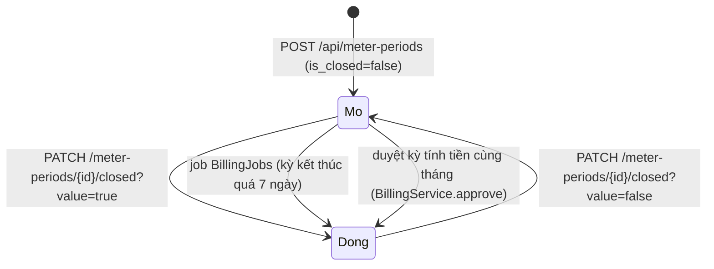

- [CODE] Mở lại được: `closePeriod(periodId, closed)` đặt thẳng giá trị, không kiểm điều kiện (`P/toan/service/MeterReadingService.java:closePeriod`).
- [CODE] Kỳ đóng: không nhập chỉ số mới (409 "Ky ghi so da dong"), không điều chỉnh (409), nhưng `confirmReading` vẫn chạy được.
- [CODE] Ai gọi được: mọi vai trò nhân viên (controller toan không có `@PreAuthorize`).

## 5.2 Kỳ tính tiền (`monthly_billing_periods.status`)

DB cho phép `DRAFT, APPROVED, PUBLISHED, CLOSED` (`db/group-7.sql`). Code chỉ dùng hai trạng thái đầu.

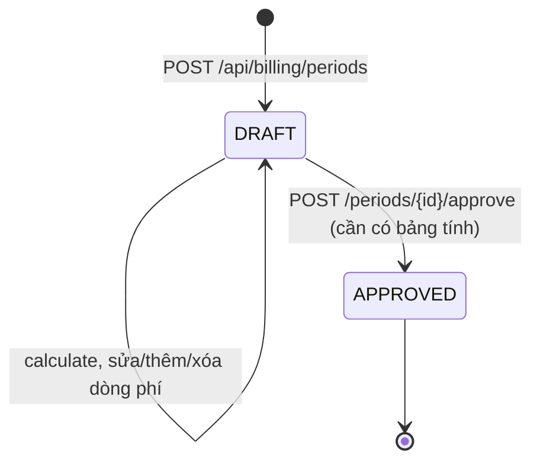

- [CODE] Chiều ngược `APPROVED -> DRAFT`: KHÔNG có (`requireDraft` chặn mọi thao tác sửa khi khác DRAFT, `BillingService.requireDraft`).
- [CODE] `PUBLISHED`, `CLOSED`: không code nào ghi (grep `"PUBLISHED"`, `"CLOSED"` chỉ thấy ở `MaintenanceService`).
- [CODE] Phát hành hóa đơn chỉ cần kỳ "khác DRAFT" (`InvoiceService.issueOne`: `"DRAFT".equals(status)` thì 409).
- Ai: `LANDLORD`, `MANAGER` (`BillingController` có `@PreAuthorize("hasAnyRole('LANDLORD','MANAGER')")` ở cấp class).

## 5.3 Hóa đơn (`invoices.payment_status`)

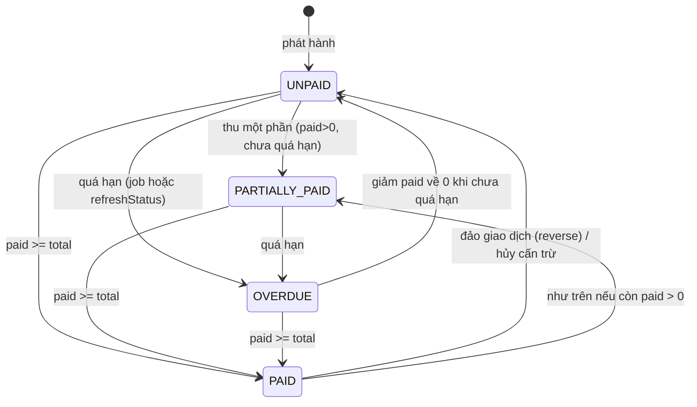

- [CODE] Quy tắc duy nhất tính trạng thái: `InvoiceBalanceCalculator.refreshStatus` (`P/toan/service/InvoiceBalanceCalculator.java`): `CANCELLED` giữ nguyên; `paid >= total` -> `PAID`; ngược lại nếu `due_date < hôm nay` -> `OVERDUE`; ngược lại nếu `paid > 0` -> `PARTIALLY_PAID`; còn lại `UNPAID`. Chú ý: hóa đơn quá hạn có trả một phần vẫn là `OVERDUE`, không phải `PARTIALLY_PAID`.
- [CODE] Chuyển ngược: có. `PrepaymentService.reverseTransaction` và `undoDeduction` trừ `paid_amount` rồi gọi `setPaid`, nên `PAID` có thể về `UNPAID/PARTIALLY_PAID/OVERDUE`.
- [CODE] `CANCELLED`: không có endpoint nào đặt. Các hàm chỉ kiểm tra trạng thái này (`PaymentService.payableInvoice`, `InvoiceService.adjustTotal`, `MaintenanceService.adjustInvoice`).
- [CODE] Có đường tắt không qua `InvoiceBalanceCalculator`: `CheckoutService.applyDepositToInvoices` tự đặt `paid_amount` và `payment_status` (`PAID` hoặc `PARTIALLY_PAID`, không xét quá hạn); `MaintenanceService.adjustInvoice` đặt `PAID` khi tổng mới <= đã trả.
- Ai: thanh toán `LANDLORD, MANAGER, CASHIER` (`CashierPaymentController`); các API của Toàn không giới hạn thêm vai trò nhân viên.

## 5.4 Giao dịch thanh toán (`payment_transactions.status`: SUCCESS, FAILED, REVERSED)

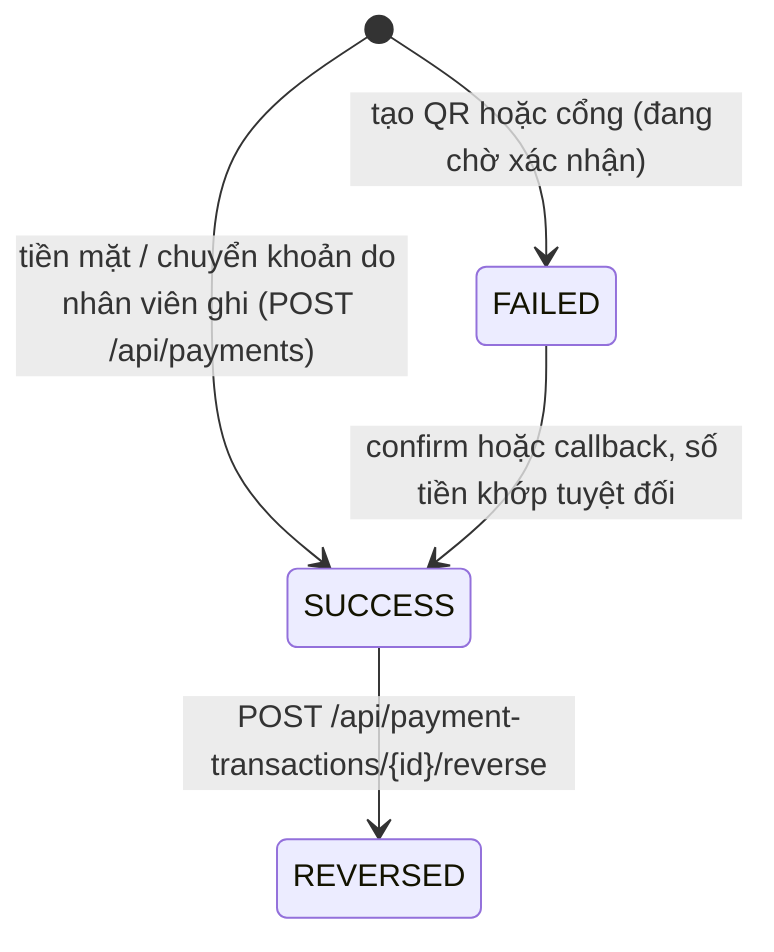

- [CODE] "FAILED" thực chất là "đang chờ" (javadoc `PaymentService`). Giao dịch chờ không có hạn hủy; không có chuyển `FAILED -> FAILED` thật (không code nào hủy giao dịch chờ).
- [CODE] `REVERSED` là trạng thái cuối. Không có chuyển ngược.
- [CODE] `PaymentService.confirmWith` từ chối nếu phương thức là `CASH` (409), nếu trạng thái không phải `FAILED` (409).

## 5.5 Hợp đồng (`rental_contracts.status`)

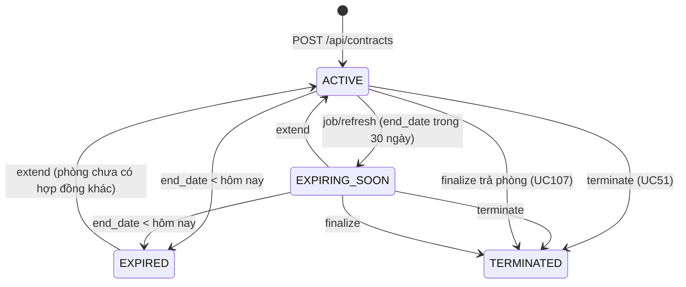

- [CODE] `TERMINATED` là cuối: `extend` từ chối (409), `liveContract` từ chối mọi sửa (409).
- [CODE] `EXPIRED` không tự đóng phòng: phòng vẫn `RENTED` cho đến khi có chấm dứt hợp đồng hoặc trả phòng (không có code đổi phòng khi hết hạn: `ContractExpiryService.refreshStatuses` chỉ đổi trạng thái hợp đồng).
- [CODE] Hai đường chấm dứt khác nhau về tác dụng phụ: `ContractService.terminate` ngừng người ở cùng và ghi `resident_stay_history`; `CheckoutService.finalizeCheckout` KHÔNG làm hai việc này (chỉ đặt hợp đồng `TERMINATED` và phòng `VACANT`). Xem Phần 13.
- Ai: `LANDLORD`, `MANAGER` (`ContractController` hằng `STAFF`).

## 5.6 Phòng (`rooms.status`: VACANT, RENTED, REPAIRING, SUSPENDED)

```mermaid
stateDiagram-v2
    [*] --> VACANT : (tạo phòng: chưa có code backend)
    VACANT --> RENTED : lập hợp đồng; gia hạn hợp đồng hết hạn; chuyển phòng (phòng mới)
    RENTED --> VACANT : chấm dứt hợp đồng; hoàn tất trả phòng; chuyển phòng (phòng cũ)
```

- [CODE] `REPAIRING`, `SUSPENDED`: không có code backend ghi. Giao diện hiển thị `REPAIRING` từ dữ liệu mẫu `frontend/src/data/sample.ts` (phòng P202).
- [CODE] Phòng không có API sửa trạng thái (phần của Chi chưa làm).

## 5.7 Yêu cầu trả phòng (`checkout_requests.status`) và phiếu hoàn cọc (`deposit_refund_vouchers.status`)

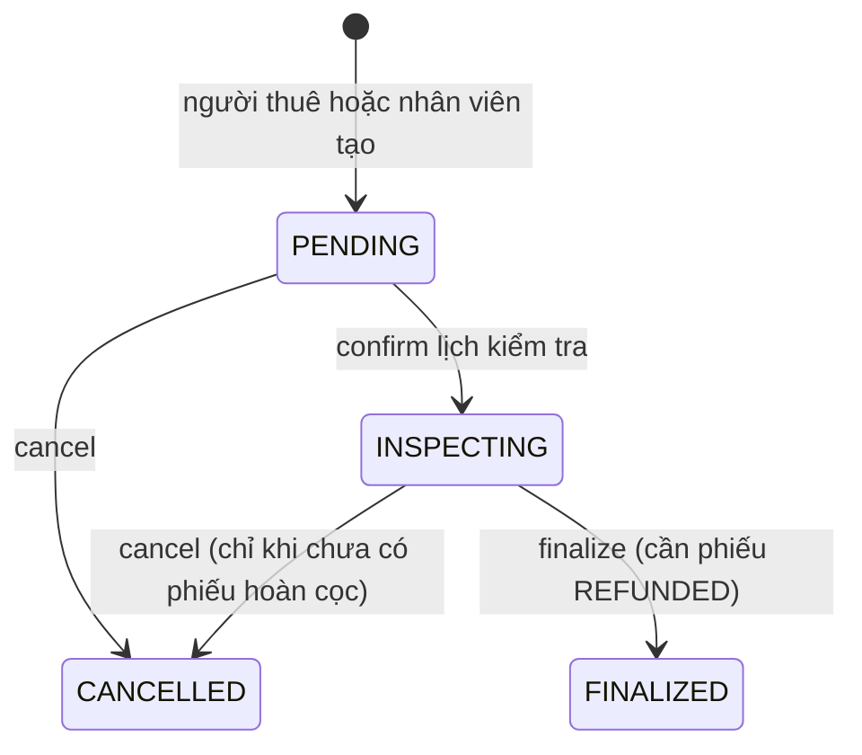

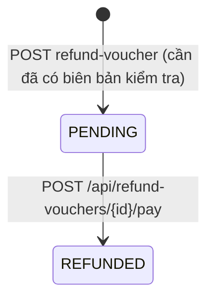

- [CODE] Không chuyển ngược. Sau khi có phiếu hoàn cọc không sửa được biên bản kiểm tra và không hủy được yêu cầu (`CheckoutService.recordInspection`, `cancel`).

## 5.8 Công nợ (`tenant_debts.debt_status`)

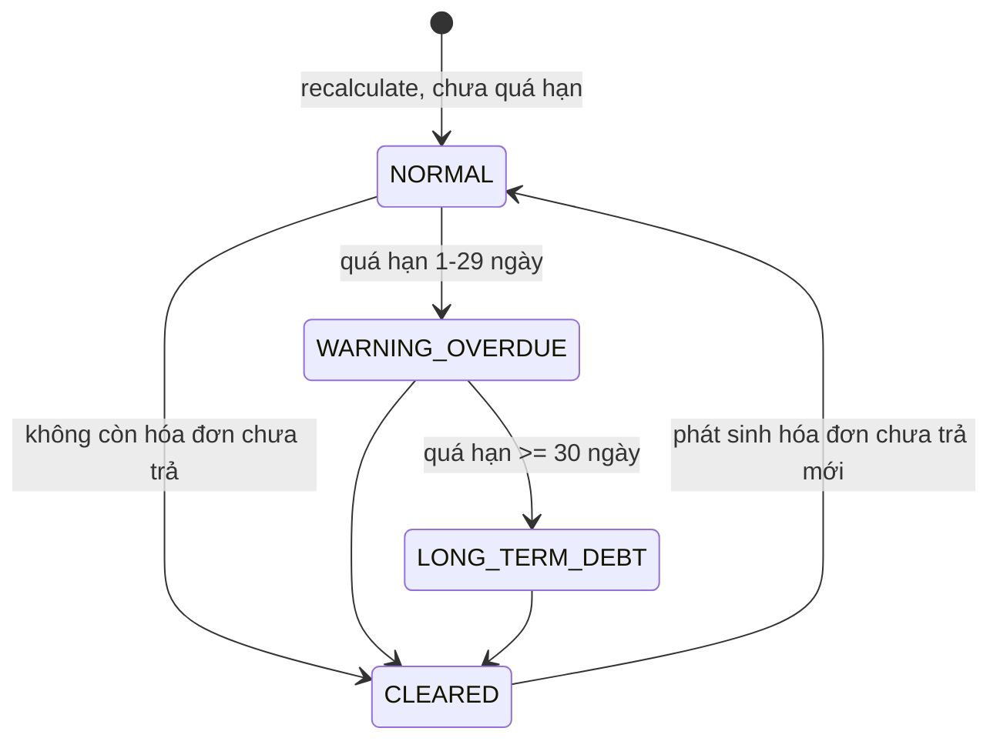

- [CODE] Trạng thái được tính lại hoàn toàn mỗi lần `DebtService.recalculate` (job 07:30 nếu `minihouse.scheduler.enabled=true`, hoặc `POST /api/debts/recalculate`, hoặc sau khi hoàn cọc). Không có hành động tay đổi trạng thái.

## 5.9 Sự cố (`maintenance_requests.status`)

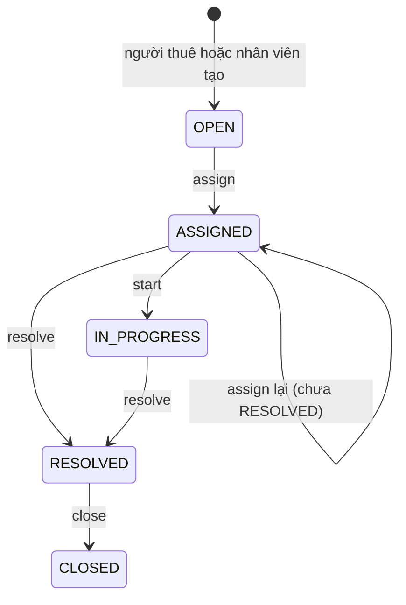

- [CODE] Không chuyển ngược. `start` chỉ từ `ASSIGNED`; `resolve` từ `ASSIGNED` hoặc `IN_PROGRESS`; `close` chỉ từ `RESOLVED` (`MaintenanceService` dòng 132-198).

## 5.10 Yêu cầu thiết bị (`room_equipment_requests.status`)

`PENDING -> APPROVED | REJECTED`, `APPROVED -> INSTALLED` (tạo `room_addon_fees`) `-> REMOVED` (tắt phụ phí) (javadoc `EquipmentService:31`). [KHÔNG RÕ] điều kiện chi tiết từng bước (chưa đọc hết `EquipmentService`).

## 5.11 Tài khoản người dùng (`users.status`: ACTIVE, INACTIVE, LOCKED)

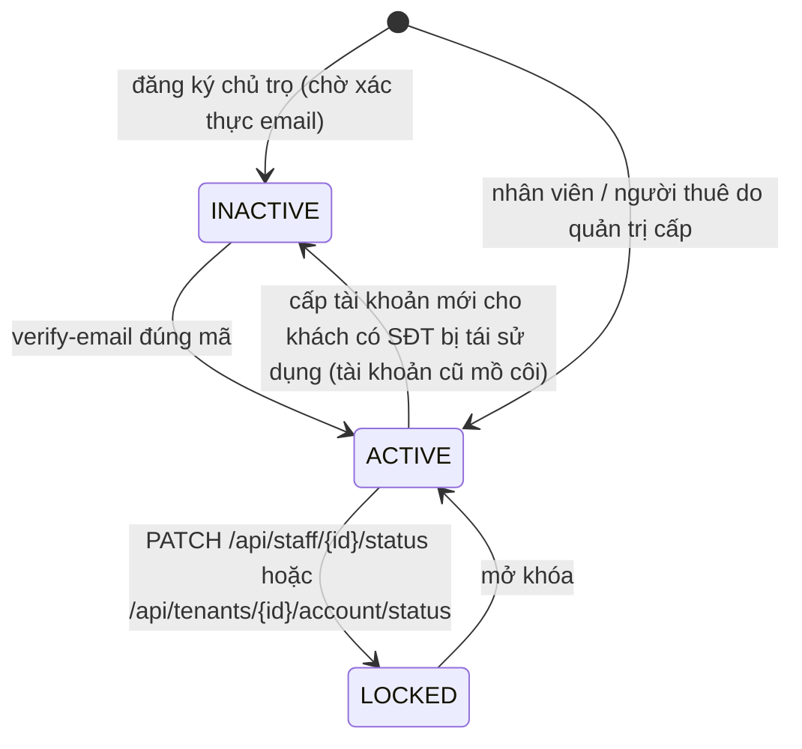

- [CODE] Khóa có hiệu lực ngay với token còn hạn: `JwtAuthFilter` gọi `UserStatusChecker.activeRoles(userId)` mỗi request; không `ACTIVE` thì coi như chưa đăng nhập (401).
- [CODE] Không có đường tự khóa khi hợp đồng hết hạn hay khi trả phòng. Việc khóa người thuê là thủ công (`PATCH /api/tenants/{id}/account/status`). `CheckoutService.finalizeCheckout` không đụng tới `users` (đọc toàn bộ file).

## 5.12 Mã OTP (`user_verifications`)

Không có cột trạng thái riêng: `is_verified=true` nghĩa là "đã dùng hoặc đã bị hủy" (`OtpService`). Hết hạn khi `expires_at` qua (TTL 10 phút). Job `PurgeExpiredVerificationsJob` xóa bản ghi hết hạn trước hơn 1 ngày.

## 5.13 Trạng thái chưa có trong code

Kỳ tính tiền `PUBLISHED`/`CLOSED`, hóa đơn `CANCELLED`, phòng `REPAIRING`/`SUSPENDED`, yêu cầu đặt giữ chỗ/thuê phòng (`booking_requests.status` có `PENDING, APPROVED, REJECTED, CANCELLED` trong DB, `db/group-7.sql:209`; ngoài entity `BookingRequest` không có service/controller nào dùng, xem lệnh grep ở Phần 15) — chỉ tồn tại trong CHECK của DB.

---

# Phần 6. Quy tắc nghiệp vụ và công thức

Mọi số tiền dùng `BigDecimal`. [CODE] grep `double|float` ngoài entity chỉ thấy một chỗ ép `Number.doubleValue()` khi xuất Excel công nợ (`DebtService.exportExcel`) và một chỗ đọc tổng công nợ (`DebtService.summary`).

## 6.1 Tính tiền tháng (`P/phi/service/BillingService.java`)

Với mỗi hợp đồng "đủ điều kiện" của khu trong tháng: `start_date <= ngày cuối tháng`, `end_date >= ngày đầu tháng`, trạng thái thuộc `ACTIVE, EXPIRING_SOON, EXPIRED, TERMINATED`, và số ngày ở thực tế > 0. Mỗi phòng chỉ tính MỘT hợp đồng (hợp đồng đầu theo thứ tự `start_date`); hợp đồng sau trong cùng tháng bị bỏ qua và ghi cảnh báo.

### Tiền phòng
- Số ngày ở = `từ max(start_date, ngày 1 của tháng)` đến `min(end hiệu lực, ngày cuối tháng)`, tính cả hai đầu. `end hiệu lực` = `end_date`, hoặc với hợp đồng `TERMINATED` là ngày của lần điều chỉnh `TERMINATED` gần nhất nếu không sau `end_date` (`effectiveEnd`).
- Nếu số ngày ở >= số ngày trong tháng: tiền phòng = giá thuê tháng. Ngược lại: `giá × số ngày / số ngày trong tháng`, làm tròn về số nguyên đồng, `HALF_UP` (`prorateRent`).
- Ví dụ [CODE, theo `prorateRent`]: giá 3.000.000, tháng 11/2026 (30 ngày), khách vào 16/11 -> ở 15 ngày -> `3.000.000 × 15 / 30 = 1.500.000`. Khách ở từ 01/11 đến 30/11 -> 30 ngày -> 3.000.000 (không chia).

### Điện, nước
- Số lượng = `used_electric` / `used_water` của `meter_readings` (cột tính toán `new - old`); đơn giá = `electric_unit_price` / `water_unit_price` của bảng giá có hiệu lực; thành tiền = `quantity × unit_price`, làm tròn 2 chữ số thập phân `HALF_UP` (`subtotal`).
- Bảng giá hiệu lực = bảng `service_rate_plans` có khoảng hiệu lực chạm tháng tính, ưu tiên bảng có `effective_start_date` muộn nhất (`ratePlan`). Chọn theo THÁNG, không theo từng ngày.
- Không có dòng điện/nước nếu phòng thiếu chỉ số (cảnh báo "tien dien nuoc = 0") hoặc không có bảng giá.
- Điện nước KHÔNG tính theo tỷ lệ ngày ở: lấy nguyên mức tiêu thụ trong kỳ ghi chỉ số.
- Ví dụ: dùng 120 kWh × 3.500 = 420.000; 6 m³ × 15.000 = 90.000.

### Dịch vụ hàng tháng (`property_service_rates` đang `is_active`)
- `FIXED_ROOM`: số lượng 1 × đơn giá. `PER_PERSON`: số lượng = số người ở × đơn giá. `PER_VEHICLE`: số xe đang hoạt động (`tenant_vehicles.is_active`) của khách đứng tên hợp đồng × đơn giá, bỏ qua nếu không có xe. `PER_METER_UNIT`: không tính tự động (chỉ nhập tay).
- Số người ở = 1 + số `room_residents` đang hoạt động của phòng mà không phải khách đứng tên hợp đồng (`othersInRoom`).
- Dịch vụ KHÔNG tính theo ngày: vào giữa tháng vẫn tính đủ tiền dịch vụ.
- Ví dụ: Internet `FIXED_ROOM` 100.000 -> 100.000; Vệ sinh `PER_PERSON` 30.000 với phòng 2 người -> 60.000; Gửi xe `PER_VEHICLE` 50.000 với 1 xe -> 50.000.

### Phụ thu, giảm trừ theo phòng (`room_custom_rates`)
- Giá > 0: dòng "Phụ thu: <tên>" cộng vào `surcharge`. Giá < 0: dòng "Giảm trừ: <tên>" (đơn giá âm) cộng vào `discount` (lưu giá trị dương). Giá = 0: bỏ qua.
- Các khoản này áp dụng MỌI kỳ tính tiền: bảng `room_custom_rates` không có cột ngày hiệu lực (`db/group-7.sql:353-359`) và truy vấn chỉ lọc theo phòng (`BillingService.calculate`). Muốn bỏ phải xóa dòng.

### Phạt trễ hạn
- `số ngày × phí trễ/ngày của hợp đồng`, với số ngày = TỔNG `overdue_days` của các dòng `tenant_debts` chưa `CLEARED` của đúng cặp (phòng, khách), chỉ khi tổng > 0 và `late_fee_per_day > 0`.
- Ví dụ: tổng 10 ngày quá hạn × 50.000 = 500.000. Lưu ý: nếu cặp (phòng, khách) có nhiều dòng `tenant_debts` chưa xong thì số ngày bị cộng dồn.
- [CODE] Công thức này khác công thức ghi `debt_penalty_logs` ở 6.4 (xem Phần 13).

### Điện nước chung
- Tổng chi phí chung = tổng `operating_expenses.amount` có `expense_category = 'Điện nước chung'`, `expense_date` trong tháng, của khu. Chia cho các phòng theo số người ở: `phần của phòng = tổng × số người của phòng / tổng số người`, làm tròn 0 chữ số `HALF_UP`.
- Không chia nếu tổng chi phí = 0 hoặc tổng số người = 0.
- Ví dụ: chi phí 600.000, phòng A 2 người, phòng B 1 người -> A = `600.000 × 2 / 3 = 400.000`, B = 200.000. Tổng các phần có thể lệch vài đồng vì làm tròn từng phòng.

### Tổng
`total = rent + electric + water + service + surcharge − discount + penalty` (`recompute`). Các cột thành phần được TÍNH LẠI từ các dòng `fee_item_details` mỗi lần sửa (nguồn sự thật là các dòng). Phân loại dòng theo TÊN dòng: "Tiền phòng", "Điện", "Nước", "Phụ thu...", "Giảm trừ...", "Phạt trễ hạn", dòng nhập tay (tiền tố `✎ `: số dương -> phụ thu, số âm -> giảm trừ), mọi dòng còn lại (kể cả "Điện nước chung (phân bổ)") -> `service`.

Ví dụ tổng: rent 1.500.000 + điện 420.000 + nước 90.000 + dịch vụ (100.000 + 60.000 + 50.000 + 400.000 chung) 610.000 + phụ thu 0 − giảm 0 + phạt 500.000 = 3.120.000.

### Dòng nhập tay
- Tên tối đa 90 ký tự, số lượng > 0, đơn giá khác 0 (âm là giảm trừ). Giữ lại khi tính lại kỳ. Dòng nhập tay của phòng không còn trong kỳ (hết hợp đồng) bị bỏ và ghi cảnh báo.

### Bất thường
- Bảng tính bất thường nếu `total > 1,5 × trung bình các kỳ khác của phòng` và trung bình > 0 (`isAnomaly`, `ANOMALY_RATIO=1.5`). Ví dụ: trung bình 3.000.000 -> cảnh báo khi > 4.500.000.

## 6.2 Chỉ số điện nước (`MeterReadingService`)

- Chỉ số cũ: từ request; nếu thiếu thì chỉ số mới của kỳ liền trước của phòng (kỳ có `end_date` < `start_date` kỳ này); nếu không có kỳ trước thì `rooms.initial_*_meter` (mặc định 0).
- Mức tiêu thụ = `new − old` (cột tính toán trong DB). Chỉ số mới < cũ: 400.
- Cảnh báo tăng đột biến: `% tăng = (dùng kỳ này − dùng kỳ trước) × 100 / dùng kỳ trước`, làm tròn 2 chữ số `HALF_UP`; cảnh báo nếu >= 50%, kỳ trước dùng >= 1, và kỳ này dùng nhiều hơn. Ví dụ: kỳ trước 100, kỳ này 160 -> 60,00% -> cảnh báo.

## 6.3 Hóa đơn và thanh toán

- Hạn thanh toán mặc định: ngày `payment_due_day` (mặc định 5, rút về cuối tháng nếu tháng ngắn hơn) của THÁNG PHÁT HÀNH; nếu ngày đó đã qua so với ngày phát hành thì sang tháng kế (`defaultDueDate`). Ví dụ: phát hành 20/11, ngày hạn 5 -> 05/12.
- `remaining_amount = total_amount − paid_amount` (cột tính toán trong DB).
- `paid_amount` được cộng từ: giao dịch `SUCCESS`, đợt thanh toán một phần (`partial_payment_logs`), cấn trừ tiền dư (`prepayment_deductions`), và gạch nợ bằng tiền cọc khi hoàn cọc. Chỉ giao dịch `payment_transactions` được tính vào doanh thu (xem 6.5).
- Tiền thừa: các API thu tiền từ chối số tiền > số còn phải trả (400, "Phan thua xu ly o chuc nang thanh toan du"). Việc "tiền dư" chỉ xảy ra khi `paid_amount > total_amount` do điều chỉnh giảm tổng hóa đơn sau khi đã thu [SUY RA từ `PrepaymentService.moveOverpaymentToBalance` yêu cầu `paid > total` và từ việc `PaymentService`/`PartialPaymentService` chặn trả quá].

## 6.4 Công nợ (`DebtService`)

- Mỗi cặp (khách, phòng) có hóa đơn chưa trả (`UNPAID, PARTIALLY_PAID, OVERDUE`, `remaining_amount > 0`) -> một dòng: `total_outstanding_debt` = tổng còn nợ; `current_period_debt` = còn nợ của hóa đơn có hạn muộn nhất; `opening_debt_balance` = tổng − kỳ này; `overdue_days` = số ngày từ hạn đến hôm nay lớn nhất.
- Phạt: ghi `debt_penalty_logs` với `số ngày × phí/ngày của hợp đồng`, chỉ khi số ngày thay đổi so với dòng phạt gần nhất. Ví dụ: 12 ngày × 50.000 = 600.000. KHÔNG tự cộng vào hóa đơn (khoản phạt trên hóa đơn đến từ `BillingService` ở 6.1).
- Mốc: `LONG_TERM_DEBT_DAYS = 30`, nhắc lần 2 từ ngày quá hạn thứ 7, nhắc cuối từ ngày thứ 15.

## 6.5 Doanh thu, chi phí (`ReportService`)

- Doanh thu tháng, doanh thu từng tháng trong năm = tổng `payment_transactions.amount_paid` với `status='SUCCESS'` theo `payment_date`. KHÔNG tính: giao dịch `FAILED` (đang chờ), `REVERSED`, đợt thanh toán một phần (`partial_payment_logs`), cấn trừ tiền dư, và phần hóa đơn gạch bằng tiền cọc (vì các khoản này không tạo `payment_transactions`).
- Chi phí = tổng `operating_expenses.amount` theo `expense_date`. Lợi nhuận = doanh thu − chi phí.
- Tiền cọc: không có chỗ nào cộng tiền cọc vào doanh thu (cọc không đi qua `payment_transactions` trừ khi có người ghi `receipt_vouchers` loại `DEPOSIT`, và phiếu thu không tạo giao dịch).
- Tỷ lệ lấp đầy = `phòng RENTED × 100 / tổng phòng`, 1 chữ số thập phân `HALF_UP`. Ví dụ: 8/12 -> 66,7. Dashboard dùng dữ liệu phòng từ bảng `rooms`.

## 6.6 Quyết toán trả phòng (`CheckoutService.settlement`)

`khấu trừ nợ = min(tổng nợ hóa đơn chưa trả của hợp đồng, tiền cọc)`; `khấu trừ hư hỏng = min(bồi thường, cọc − khấu trừ nợ)`; `hoàn = cọc − khấu trừ nợ − khấu trừ hư hỏng`; `phải trả thêm = (nợ − khấu trừ nợ) + (bồi thường − khấu trừ hư hỏng)`.
Ví dụ: cọc 3.000.000, nợ 1.200.000, bồi thường 2.000.000 -> khấu trừ nợ 1.200.000, khấu trừ hư hỏng `min(2.000.000, 1.800.000) = 1.800.000`, hoàn 0, phải trả thêm 200.000. Nợ được ưu tiên khấu trừ trước hư hỏng.

[CODE] Quyết toán KHÔNG tính tiền phòng và điện nước của phần tháng cuối: chỉ có các hóa đơn đã phát hành (`unpaidInvoices`) và bồi thường. Chỉ số điện nước cuối (`final_electric_meter`, `final_water_meter`) được lưu vào biên bản nhưng không tạo `meter_readings` và không đi vào bảng tính tiền.

## 6.7 Bảng hằng số hard-code (số, chuỗi, ngưỡng)

| Giá trị | Ý nghĩa | Bằng chứng |
|---|---|---|
| `false` | `app.security.enabled` mặc định | `application.properties`, `SecurityConfig.java:44` |
| `dev-only-secret-minihouse-group7-change-me-2026` | khóa JWT mặc định | `application.properties` |
| 480 phút | hạn token | `application.properties`, `JwtService.java:22` |
| 5MB / 6MB | giới hạn upload file / request | `application.properties` |
| `http://localhost:*`, `http://127.0.0.1:*` | origin CORS cho phép | `SecurityConfig.java` (`corsConfigurationSource`) |
| `admin@minihouse.local` / `Admin@123` | tài khoản admin seed | `db/seed.sql`, README mục 3 |
| 8 ký tự, có chữ và số | mật khẩu hợp lệ | `AccountService.isStrong:144` |
| 10 ký tự, bảng chữ bỏ `0 O 1 l I` | mật khẩu tạm | `PasswordGenerator.java:8-9` |
| 6 số, 10 phút, 60 giây | OTP: độ dài, TTL, giãn cách xin mã | `OtpService.java:27-28,45` |
| 1 ngày | xóa mã OTP hết hạn sau | `PurgeExpiredVerificationsJob.java:33` |
| 2 MB / 2 MB / 1 MB | ảnh đại diện / ảnh QR / ảnh chữ ký tối đa | `AccountService:24`, `BankAccountService:27`, `ContractService:55` |
| 20 mặc định, 100 tối đa | cỡ trang | `ContractService:148`, `PaymentService:188`, `StaffService:44-45`, `ActivityLogService:26-27`, `VietSupport:13` |
| 5.000 | số dòng nhật ký tối đa khi xuất | `ActivityLogService:28` |
| 50.000 | số dòng tối đa khi xuất Excel/PDF | `TableExporter.java:50` |
| 5 | ngày hạn thanh toán mặc định (hợp đồng, hóa đơn) | `ContractService:115`, `InvoiceService:375` |
| 1 tháng | chu kỳ thanh toán mặc định của hợp đồng | `ContractService` (`cycle` mặc định 1) |
| 0 | phí trễ/ngày mặc định của hợp đồng | `ContractService.create` |
| 255 | độ dài tối đa lý do chấm dứt hợp đồng | `ContractService.terminate` |
| 30 ngày | hợp đồng "sắp hết hạn" | `ContractExpiryService.DEFAULT_DAYS`, `ReportService.dashboard` (`plusDays(30)`) |
| 3 và 1 ngày | nhắc thanh toán trước hạn | `BillingJobs.remindAndMarkOverdue` |
| 7 ngày | giãn cách thông báo quá hạn; số ngày chờ trước khi tự đóng kỳ chỉ số | `InvoiceService.markOverdueAndNotify` (`minusDays(6)`), `BillingJobs` (`meter-grace-days`) |
| 1,5 | hệ số hóa đơn bất thường | `BillingService.ANOMALY_RATIO` |
| 50 (%) | ngưỡng tăng đột biến điện nước | `MeterReadingService.ANOMALY_THRESHOLD_PERCENT` |
| 999,99 | trần % cảnh báo (cột DECIMAL(5,2)) | `MeterReadingService.checkUsage` |
| 90 | độ dài tối đa tên khoản nhập tay | `BillingService.addItem` |
| 30 / 7 / 15 ngày | nợ kéo dài / nhắc lần 2 / nhắc cuối | `DebtService:64-67` |
| "Điện nước chung" | tên nhóm chi phí được phân bổ vào hóa đơn | `BillingService.SHARED_CATEGORY` |
| `Bảo trì, Vệ sinh, Thuế, Điện nước chung, Khác` | nhóm chi phí mặc định | `OperatingExpenseService.DEFAULT_CATEGORIES` |
| `✎ ` | tiền tố dòng nhập tay | `BillingService.MANUAL` |
| `INV-yyyyMM-<phòng>-<id>`, `HDyyyyMMdd-<phòng>`, `QR-xxxxxxxx`, `GW-xxxxxxxx` | định dạng mã hóa đơn, hợp đồng, giao dịch QR/cổng | `InvoiceService.buildCode`, `ContractService.newCode`, `PaymentService.createQr` |
| `0 0 1 * * *`, `0 0 8 * * *` | cron job đóng kỳ chỉ số, nhắc hạn | `BillingJobs` |
| `0 30 0 * * *`, `0 30 7 * * *`, `0 30 8 * * *` | cron gia hạn trạng thái hợp đồng, tính nợ, nhắc nợ | `VietJobs` |
| `1` (PROPERTY_ID) | giao diện luôn dùng khu trọ id = 1 | `frontend/src/lib/api.ts:5` |
| `ROLE`: `LANDLORD, MANAGER, CASHIER, METER_READER, TENANT` | tập vai trò | `RolePermissions.ROLES` |

---

# Phần 7. Validation

Kiểm tra ở BACKEND bằng hai cách: (a) annotation Bean Validation trên DTO, chỉ có ở 9 DTO của package `phi` (`LoginRequest`, `ChangePasswordRequest`, `ForgotPasswordRequest`, `ResetPasswordRequest`, `VerifyEmailRequest`; chỉ `@NotBlank`), (b) câu lệnh `if ... throw` trong service. DTO của `toan` và `viet` không có annotation validation (grep `@NotBlank|@NotNull|@Size|@Min|@Valid` trong `toan/dto`, `viet/dto` không có kết quả); kiểm tra nằm trong service.

[CODE] Lỗi validate trả về HTTP 400 với `ApiResponse.error(message)` (`GlobalExceptionHandler`); lỗi nghiệp vụ dùng `BusinessException` hoặc `ResponseStatusException` (toan dùng loại sau).

## 7.1 Có kiểm tra (backend)

| Trường | Quy tắc | Bằng chứng |
|---|---|---|
| Mật khẩu mới (đổi, đặt lại, đăng ký) | >= 8 ký tự, có ít nhất 1 chữ và 1 số; KHÔNG có giới hạn độ dài tối đa | `AccountService.isStrong` |
| Họ tên (nhân viên, đăng ký) | không rỗng, <= 100 ký tự | `StaffService:188`, `RegistrationService:56` |
| Email | đúng regex và <= 255 ký tự | `StaffService:196`, `RegistrationService:60` |
| SĐT nhân viên và SĐT đăng ký chủ trọ | 9-15 chữ số, có thể bắt đầu bằng `+`, không dấu cách | `StaffService:200`, `RegistrationService:65` |
| Vai trò nhân viên | chỉ `MANAGER, CASHIER, METER_READER`, ít nhất 1 | `StaffService.normalizeRoles` |
| Ngày hợp đồng | kết thúc phải sau bắt đầu | `ContractService.create` |
| Giá thuê, cọc, chu kỳ, ngày hạn | giá thuê > 0; cọc >= 0; chu kỳ thanh toán 1 đến 12 tháng; ngày hạn thanh toán 1 đến 28 | `ContractService.checkPricing:500-513` |
| Phí trễ hạn | không âm | `ContractService.create`, `updatePaymentTerms` |
| Chỉ số điện nước | không âm (move-in), mới >= cũ | `MeterReadingService` |
| Lý do điều chỉnh chỉ số, hóa đơn, chấm dứt hợp đồng | bắt buộc không rỗng | `adjustReading`, `adjustTotal`, `terminate` |
| Số tiền thanh toán | > 0 và <= số còn phải trả | `PaymentService.checkAmount`, `PartialPaymentService.record` |
| Mã giao dịch | <= 100 ký tự, không trùng | `PaymentService.cleanCode`, `newTransaction` |
| Biển số xe | duy nhất trong hệ thống (`UQ_vehicle_plate`) | `OccupancyService.addVehicle` |
| Số người ở cùng | `người ở cùng + 2 <= max_occupants` | `OccupancyService.addResident` |
| Đơn giá, phí dịch vụ | không âm; loại tính thuộc 4 giá trị | `ServiceRateService` |
| Ngày kỳ ghi chỉ số | kết thúc >= bắt đầu | `MeterReadingService.createPeriod` |
| Ảnh upload (avatar, QR, chữ ký) | không rỗng, không vượt dung lượng, nhận dạng loại ảnh PNG/JPEG/WebP bằng nội dung file (`detectImageExtension`), tên file là UUID | `FileStorage.saveImage:33-54` |
| Số trang | `size < 1` -> mặc định, tối đa 100 | các service |
| Trạng thái, `chargeType`, `method` | thuộc tập hợp cho phép | nhiều service |

## 7.2 KHÔNG kiểm tra (hoặc không thấy kiểm tra)

- [CODE] Số điện thoại của khách thuê (hồ sơ `tenants`) và người ở cùng: không có định dạng bắt buộc ở backend (hồ sơ `tenants` do `chi`, chưa có code). Trường `phone_number` của `room_residents` chỉ được cắt khoảng trắng [SUY RA từ `OccupancyService.fill`, chưa đọc].
- [CODE] Mật khẩu: không giới hạn độ dài tối đa (BCrypt chỉ dùng 72 byte đầu).
- [CODE] Đăng nhập: không giới hạn số lần thử sai, không khóa tạm (`AuthService.login` không đếm).
- [CODE] Chỉ số điện nước nhập tay `oldElectric`, `oldWater` trong request được tin (ghi đè chỉ số cũ tự lấy) và không được đối chiếu với kỳ trước (`resolveOldValues`).
- [CODE] `recordedByUserId`, `adjustedByUserId`, `changedByUserId` trong DTO của Toàn lấy từ BODY do client gửi, không lấy từ token (`P/toan/dto/MeterDtos.java:23,36`, `RateDtos.java:21`), không kiểm tra khớp người đang đăng nhập.
- [CODE] `photoUrl` ảnh công tơ chỉ là chuỗi URL, không kiểm tra định dạng.
- [CODE] Tạo hóa đơn: `issueDate`, `dueDate` không bị chặn phát hành vào quá khứ xa; chỉ kiểm hạn không trước ngày phát hành.
- [CODE] Phiếu thu `POST /api/receipts`: không kiểm số tiền khớp giao dịch/hóa đơn (`ReceiptService.create` chỉ kiểm loại phiếu và số tiền > 0).
- [CODE] Không kiểm tra trùng hai hợp đồng của một khách (một khách nhiều hợp đồng là hợp lệ).
- [CODE] Quyền sở hữu khi bảo mật TẮT: không có (mọi API mở).

## 7.3 Frontend

- [CODE] Giao diện có kiểm tra bắt buộc/độ dài ở vài form (grep `required|min|max` khớp ở `contracts.ts` 19 chỗ, `settings.ts` 7, `meters.ts` 6, `billing.ts` 4, `payments.ts` 3, `maintenance.ts`, `login.ts`, `expenses.ts`).
- [KHÔNG RÕ] Chưa rà từng form xem quy tắc nào chỉ có ở frontend. Quy tắc nghiệp vụ quan trọng đều nằm ở backend (mục 7.1). Nút "Thêm phòng", "Thêm khách thuê" bị `disabled` (`frontend/src/pages/rooms.ts:38`, `tenants.ts:37`).
